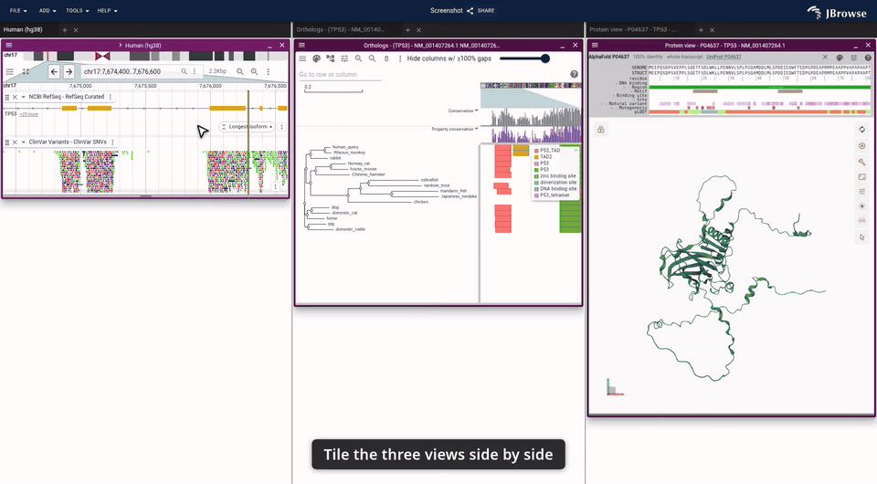
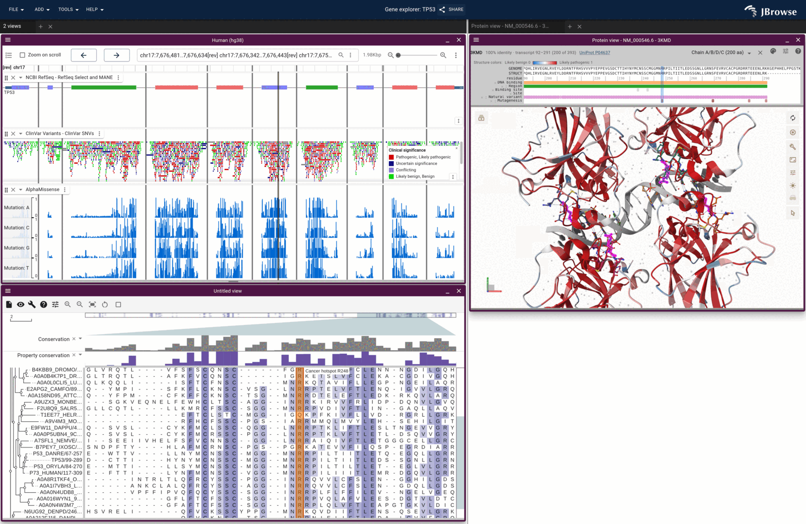
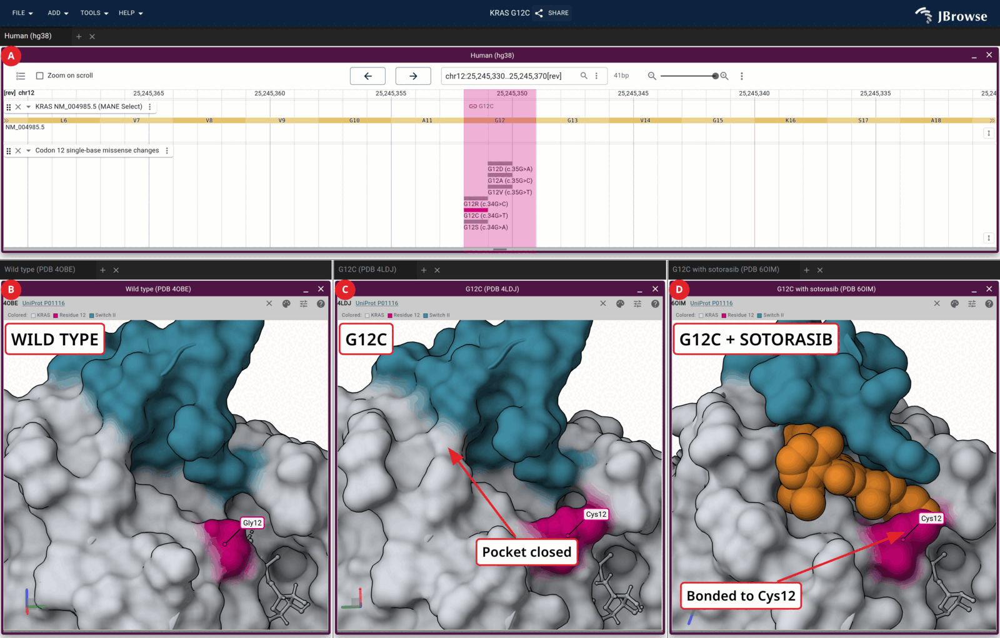

# proteinbrowser

- **In:** a gene symbol
- **Out:** a linked JBrowse 2 session with exons, a 3-D structure and a cross-species protein alignment

**[Try the Protein Browser](https://genomes.jbrowse.org/protein-browser/)**, or open
[TP53 on R248](https://genomes.jbrowse.org/protein-browser/?gene=TP53&ref=9606&residue=248&structure=3kmd),
a cancer hotspot.

A missense variant changes one codon. What it does depends on where the residue
sits in the fold and how conserved it is across related proteins. The session
puts the codon, the structure and the alignment side by side, linked.

Add any JBrowse track beside the codon and more than one structure beside the
gene. KRAS G12C, in wild type, G12C and G12C bound to sotorasib:

## Tutorials

- [genomes.jbrowse.org proteins](https://jbrowse.org/jb2/docs/tutorials/genomes_proteins/) — the Protein Browser, and the right-click launcher on any gene
- [TP53 R248 and R273 on DNA](https://jbrowse.org/jb2/docs/tutorials/protein_variants_tp53/)
- [KRAS G12 in the GTP pocket](https://jbrowse.org/jb2/docs/tutorials/protein_variants_kras/)
- [BRAF V600 in the activation loop](https://jbrowse.org/jb2/docs/tutorials/protein_variants_braf/)
- [Sickle cell, from GWAS hit to haemoglobin S](https://jbrowse.org/jb2/docs/tutorials/protein_variants_sickle_cell/)

## Figures

- [Gallery](docs/gallery.md) — 13 live sessions: TP53, KRAS, BRAF, BRCA1, CCR5 and more
- [The paper's figures](docs/figures.md)

## Libraries

- [g2p_mapper](https://github.com/GMOD/g2p_mapper) — maps a transcript's coding positions to structure residues
- [p2s_mapper](https://github.com/GMOD/p2s_mapper) — maps a protein sequence to a structure
- [jbrowse-plugin-protein3d](https://github.com/GMOD/jbrowse-plugin-protein3d) — Mol\* structure views in JBrowse 2
- [jbrowse-plugin-msaview](https://github.com/GMOD/jbrowse-plugin-msaview) — JBrowseMSA inside JBrowse 2
- [JBrowseMSA docs](https://gmod.org/JBrowseMSA/)
- [All repositories and data services](docs/software.md)

## Related browsers

- [genomes.jbrowse.org](https://genomes.jbrowse.org) — JBrowse 2 for every UCSC genome; right-click a gene to launch a protein view
- [Ensembl Compara and TreeFam browser](https://jbrowse.org/demos/msafam/) — gene trees and alignments, JBrowseMSA standalone
- [Uniprot Browser](https://cmdcolin.github.io/uniprot_browser) — UniProt protein annotations

## Cite

> Diesh, C., Stevens, G., Bridge, C., Hogue, G., Buels, R., Cain, S., Stein, L.,
> & Holmes, I. (2026). Proteins in the Genome Browser: Integration of
> Phylogenies, Alignments, and Structures With Nucleotide-level Evidence in
> JBrowse 2. _Journal of Molecular Biology_, 438(18), 169645.
> https://doi.org/10.1016/j.jmb.2026.169645

Also in [CITATION.cff](CITATION.cff).

## License and contact

MIT, in [LICENSE](LICENSE). [Contact us](https://jbrowse.org/jb2/contact) or open a GitHub issue.
