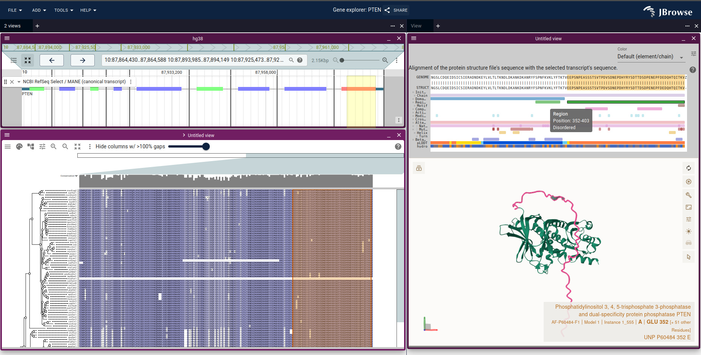
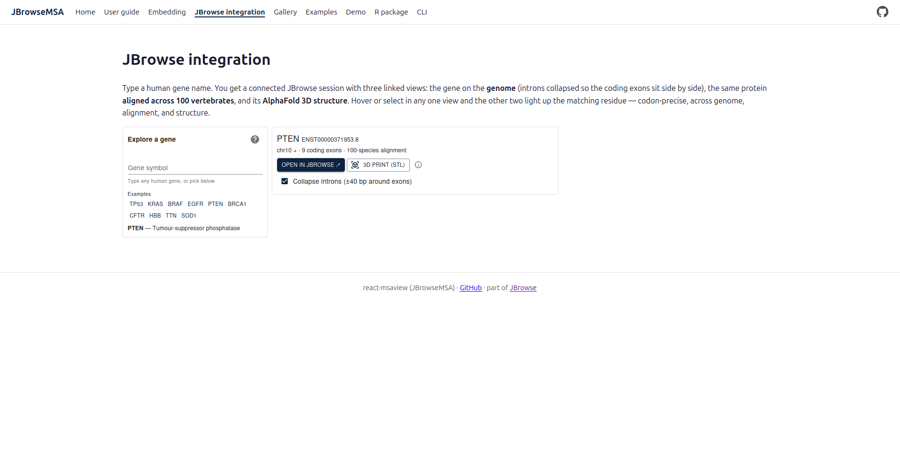

# proteinbrowser

- **In:** a gene symbol
- **Out:** a linked JBrowse 2 session with exons, a 3-D structure and a cross-species protein alignment

**[Try the Protein Browser](https://genomes.jbrowse.org/protein-browser/)**, or open
[PTEN](https://genomes.jbrowse.org/protein-browser/?gene=PTEN) directly.
Hover a residue and its codon lights up in every view.

## More

- [genomes.jbrowse.org](https://genomes.jbrowse.org) — JBrowse 2 for every UCSC genome; right-click a gene to launch a protein view ([tutorial](https://jbrowse.org/jb2/docs/tutorials/genomes_proteins/))
- [Ensembl Compara and TreeFam browser](https://jbrowse.org/demos/msafam/) — gene trees and alignments, JBrowseMSA standalone
- [Uniprot Browser](https://cmdcolin.github.io/uniprot_browser) — UniProt protein annotations
- [The paper's figures](docs/figures.md)
- [Software and data services](docs/software.md)
- [JBrowseMSA docs](https://gmod.org/JBrowseMSA/)

## Cite

> Diesh, C., Stevens, G., Bridge, C., Hogue, G., Buels, R., Cain, S., Stein, L.,
> & Holmes, I. (2026). Proteins in the Genome Browser: Integration of
> Phylogenies, Alignments, and Structures With Nucleotide-level Evidence in
> JBrowse 2. _Journal of Molecular Biology_, 438(18), 169645.
> https://doi.org/10.1016/j.jmb.2026.169645

Also in [CITATION.cff](CITATION.cff).

## License and contact

MIT, in [LICENSE](LICENSE). [Contact us](https://jbrowse.org/jb2/contact) or open a GitHub issue.
