# Gallery

Each image opens its live session on a hosted JBrowse 2 with the protein3d and msaview plugins loaded. Hover the highlighted codon in the genome view and each protein view lights the residue it codes for.

## TP53 R248: CRISPR scan and AlphaMissense

[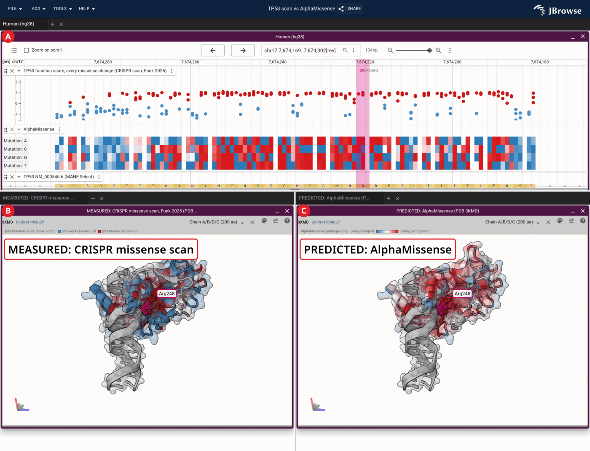][tp53_scan_alphamissense]

TP53 at codon 248 with the Funk 2025 CRISPR scan and AlphaMissense, above the p53 dimer on DNA (3KMD) colored by the scan's mean per codon on the left and by AlphaMissense on the right.

## TP53 Y220C and rezatapopt

[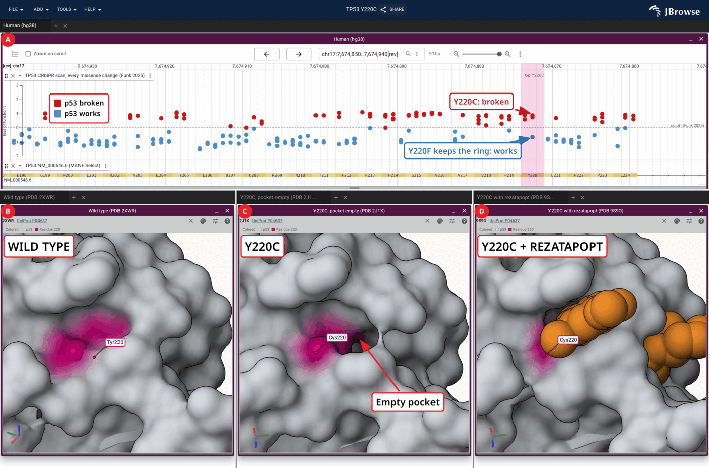][tp53_y220c]

TP53 with every missense change of a CRISPR scan around codon 220, above the p53 surface at residue 220 in wild type (2XWR), Y220C (2J1X) and Y220C bound to rezatapopt (9S9O), all from one camera.

## TP53 R273H on DNA

[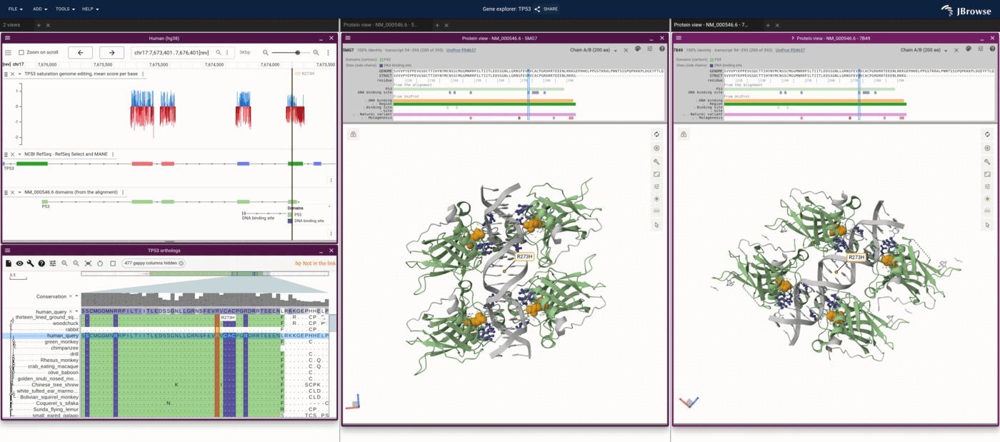][tp53_r273h]

TP53 with a saturation genome editing score track, the alignment's domains and two protein views: 5MG7 and 7B49, both bound to DNA. R273H is labelled in every view.

## KRAS G12C and sotorasib

[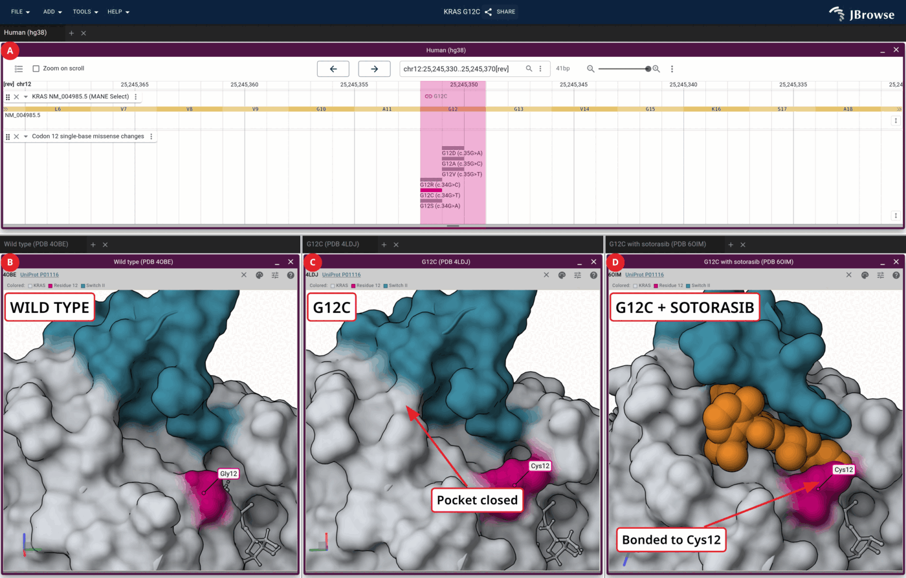][kras_g12c]

KRAS at codon 12 with its single-base missense changes, above the KRAS surface at residue 12 in wild type (4OBE), G12C (4LDJ) and G12C bound to sotorasib (6OIM), all from one camera, with switch II colored.

## BRAF V600E

[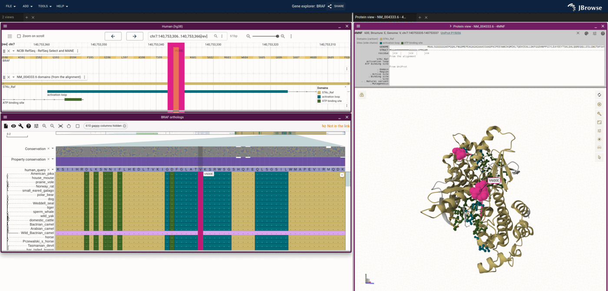][braf_v600e]

BRAF with the activation loop and the ATP binding site as domain colors in the genome view, the alignment and 4MNF.

## BRCA1 M1775: saturation genome editing

[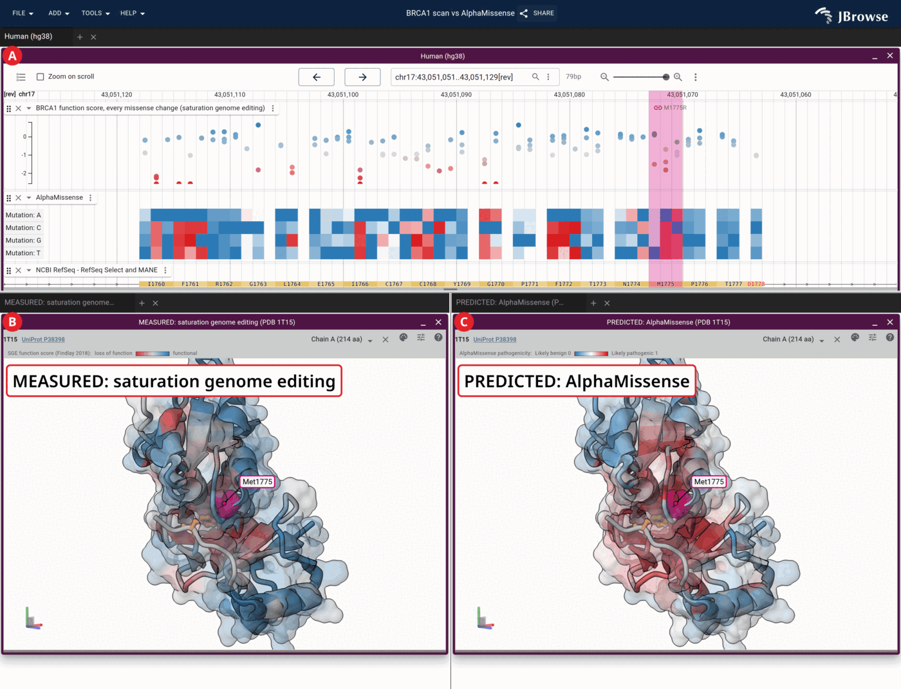][brca1_sge_alphamissense]

BRCA1 at codon 1775 with the saturation genome editing score of every missense change and the AlphaMissense score of every possible base change, above 1T15 twice: colored by the scan's residue mean on the left and by AlphaMissense on the right. The M1775R highlight names the residue in both structures.

## BRCA1 M1775R in the BACH1 pocket

[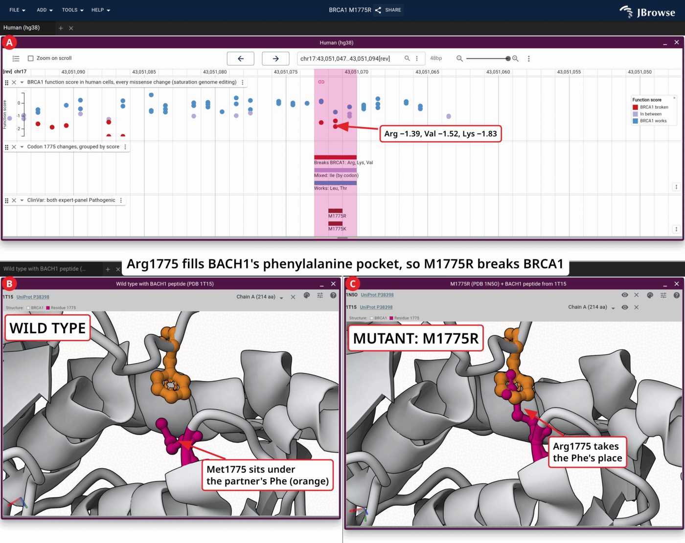][brca1_m1775r_pocket]

BRCA1 with saturation genome editing scores and ClinVar records at codon 1775, above 1T15 with the BACH1 peptide and 1N5O, the M1775R crystal, with that peptide superposed from 1T15.

## SNCA E46K fibrils

[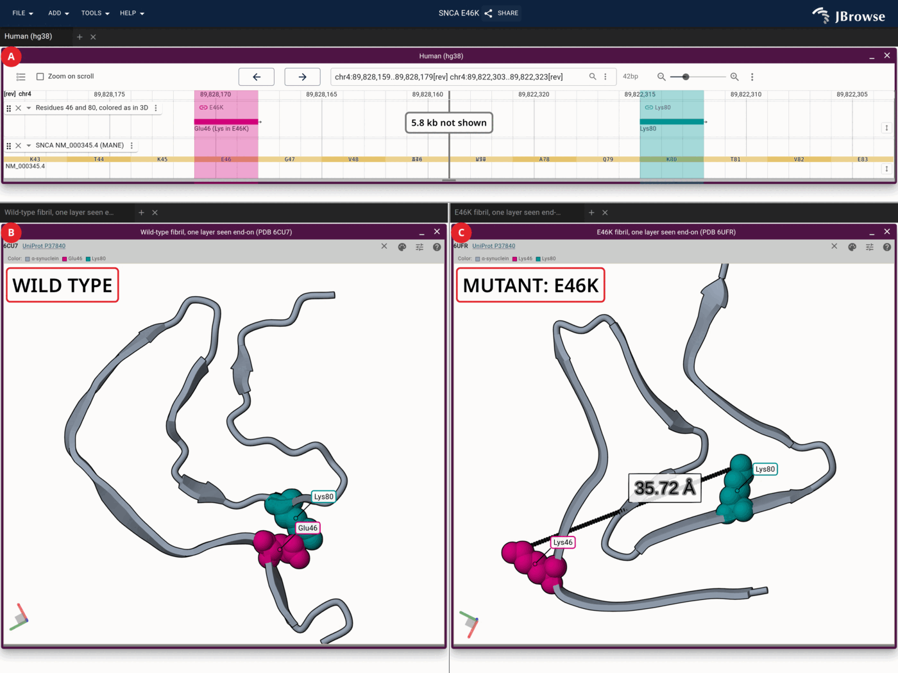][snca_e46k]

SNCA codons 46 and 80 above one layer of the wild-type rod polymorph (6CU7) and the E46K (6UFR) α-synuclein fibrils, turned so Lys80 sits at the same place in both, with the distance between residues 46 and 80 drawn in the mutant.

## CFTR F508

[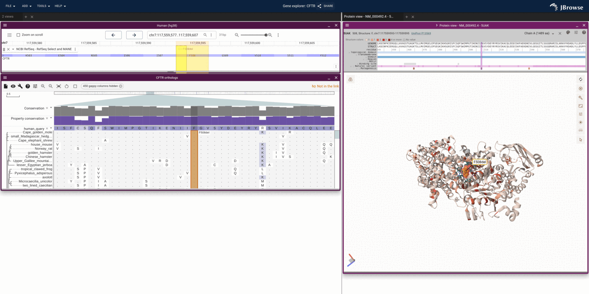][cftr_f508]

CFTR with its ortholog alignment and 5UAK colored by ClinVar pathogenic variant count.

## HBB E6V, sickle haemoglobin

[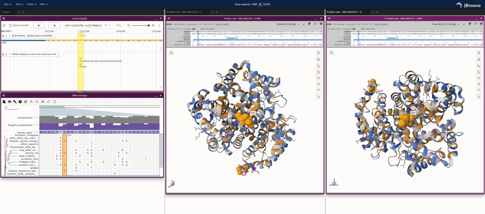][hbb_e6v]

HBB with the GWAS Catalog records at the codon and two protein views, 2HHB and 2HBS, colored by hydrophobicity.

## CCR5 Δ32: reads, both alleles and the receptor

[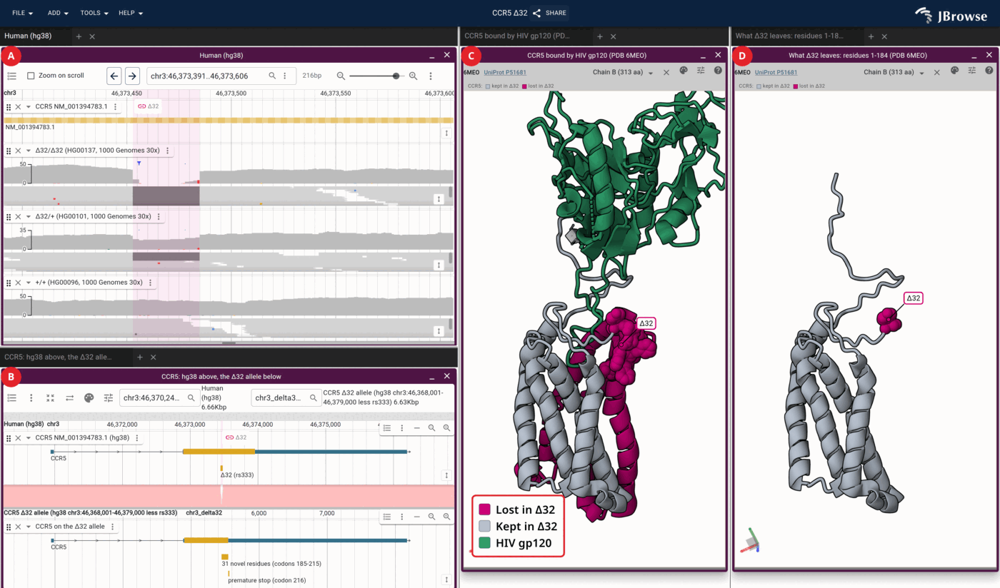][ccr5_delta32_combo]

CCR5 Δ32 in one session: the three samples' reads over the deletion, CCR5 on hg38 above the Δ32 allele as its own assembly, and the receptor drawn whole beside the part the frameshift spares.

## APOE under an Alzheimer's GWAS

[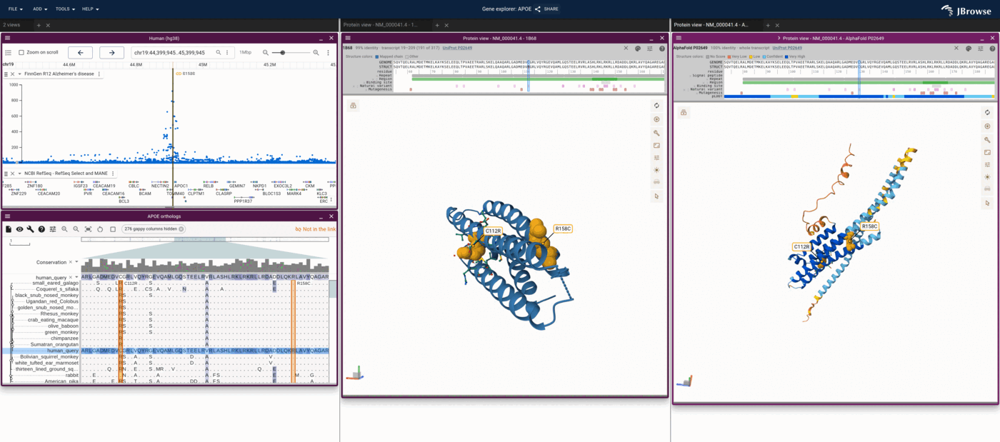][apoe_e4]

APOE under a Manhattan plot of FinnGen Alzheimer's disease statistics, above the ortholog alignment and two protein views: the 1B68 crystal structure and its AlphaFold model colored by pLDDT.

## F5 Leiden under a thrombosis GWAS

[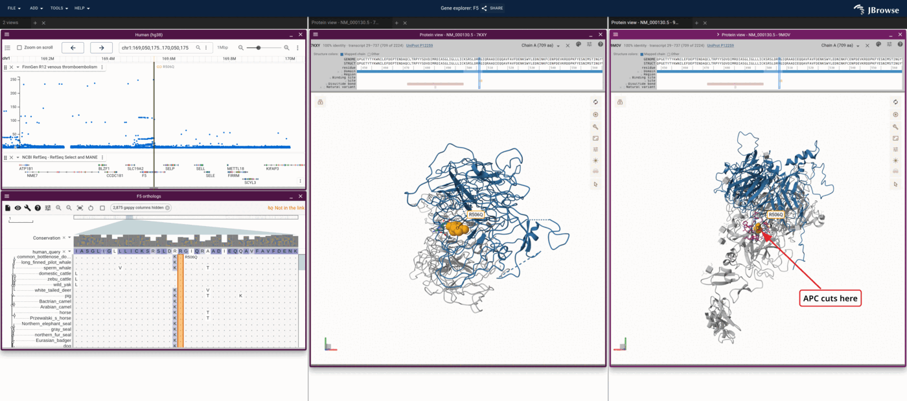][f5_leiden]

F5 under a Manhattan plot of FinnGen venous thromboembolism statistics, with the alignment and two protein views: factor Va alone (7KXY) and bound to activated protein C (9MOV).

[tp53_scan_alphamissense]:
  https://jbrowse.org/code/jb2/main/?config=https://jbrowse.org/ucsc/hg38/config.json&session=encoded-eJztWetuq0gSfhWrz5-MhB0uvvJjJWIwtsDeNs06io6sozZ0gA23acCZnCM_wL7HPNk8yarAsXE2yZnsrPZXbMnGdFH1VXV13fwDpTRhSEUuHiidwqNpZ190tDgP6TIqCpYWDAloH7HHAqlff6DIRyqKg30X6JGAyqccnrajlFFusjRL2CZij0hAXhZn_OZpqhOk3tO4YAIKI5_NGfUZ__uecWCK1JJXTEC0KFiyi5-QisJAGSMBxZmHVOSFXBqpo-GoLw0nXfhWRPkrZ_styObUe2hg1ZcLwFbmA6VbBIA6ZFEQlkiVZPEgtGlARJe-0PGZeiK-0Oo2CoKY6VGRx_QJCSih_AGpqMhpigTEM7AMKrKKe8AmZgFLfaT-QEWYPR5VPwiIpV7mR2kAK7VpahKPxgwujgLjWiBwpWnAkPoVfZG90W43RAL6cl-_4MofSRPJQ1sB-VlCo3QJuyL2BofDQWh4FsD0CT6eKVKkiid6-htSJaD-D8slNG0bYyAetkBVb3vOs5JFab313YTRouLMP_sAbpaP2-839lo13rU0NPIPx9DVztRZEOx0kqPha5cTOrMqfejIojzoXGH9pqNYS_2XNgxZFND3LEvc7IYWzGZ7Fp-8CuysxVGQJiwtz3ejOMwqVpZgi8bJTma_j1hcawy6PzvShfeAerC7RUlLpKLjrzIqYbtQPlA691XqlVGWdgov46xzddIAcB_3FZUhZ0WYxWClxvRI_Spu2_vbvx_fe_X-egNpJ-1gV2O6YzE4di3pMeMPReeqkfPHv37viCACVnY8e2Dp89LfYGELHlDyyisrzpqzkfu7WjflIQEcraPmszwrorLeRC-kUVrL1JCAbpCADCSgGcC5ZxS4geWqNPq1YjW71fKbKIqD_rA3PPtA4qzgcc7ujxtfH-DGkLxE6mg4nAzFMRwHH36NhoNJv0ZM4UZXEp7j0SX7otodURzPeyMOgsubvIeTIZzlNu88pAUD1xfeYjESL-CJI2nwKgvxHRbKQOmfWSg1w1dYyO-xGIlii8VYGX1Ykb40brHoy2_Y4j1F-uNByxb9yUj6sCIDcSCfWQxkZfhhFIPJRGk5jDySP8xiqIylFou-qHzYnMM6Br3tticUcAKrgnHMs33kM9_lNC08HuUlYb9WLPWaeGjgNdEx2RgY22RtuDOi27eWbWNjtdrYBNuYrLWlrttLm2BdXxjr25lr6NjEuqFhZ4kNTcN4o2ENaxp24QPe5BbbhJANJmvLvVub5M6cObY5s-fEdDWLbNype0ewZq-s5Wy6tjXLneLN2r7d6MTFGJuus3G0pba4s9ZkPV-6xmbjOFM8nxvOlOhEN20N4_XcXjgbw1zZzsa4s3XdWbkzZ042mw2-MzA2NibRp667mN-t7pbTFSHTpWkuV46DF7a7WLi2oRNirmzbdFZkZmyczVSbYtPRHcc1DGNlO5ZlGiDVxtgkruVoNl6tXEIIXmPLsrCtm8bdzLXXC8d0DGdmLGeOYa8MzTZsS9fWmmkZ2DSJo80JmdsWsSxzTVzizC3LXs4s1zCxTvS6UElT5pXMh8y1uKhvDtsm3TdBB0IlUpGmyv1xuw4IGYSlN1L8nsYVPPXFl0RxRNHhAEyLit9Trw6pWU69qHyCBK4MDgLyaMI4hZU6OEcZ5IzuYNzry7IwkXvSWBG6Y7HXl8ZbAZWUB6wECmnYGyqK0JWUXn8yELrSuDdUtgKqcsg5vYk8UQSxpwwnfUHsiaICa0nmA7aMl2EWcJqHkYcOAso8L66KWjJkztcLgJwzP_LKP1sBYMfQF1MXSoCL6vL_mvAva77PVPmZKj9T5Weq_EyVn6nyf5UqATAr4Ibbmk4052Rd0bSMSlpGe-a-2Xoi4WIkc9lnCh22Z_zp3D57IXSSnatjW_2im_6llcQgy9RJqx6wbAVEfZqXjLfGDzfMN0E1l-6i37TjsoAqHsHQpCzzQr2-_ucORh6sl_Hg2mdJVlwD8m9FwK4BcK8IWO8ZXm935NgLvoO1jiXBhVVeH7IcKS-b8nfnMXkWpSXEoeg7Q-rkL05i_qvO_Sfzl67UG16MYOSeDD7eCqV_zkWepxMvR3dCBxaOE4mc8c6O1qOtj7hAFNxGwV_Z--ej-A2w9HaP6NDSb9ZUJm-odhw-tdVq1Tadq6W2MjqExcwrP-jZM54l0yy9b6t2USV9Vmuf1dpntfaTam1bJ-QwCsIY2rTGY9un8Dy-f-egjPqy1La-LEunVg3xYEevZHEiiIIky5CF4aTXA1GkIkfuj9d1qVEV7Bbmojn1zv0e9SBuYpqyuD7JOVx1yyyvWTxlVQkhoW5ld5ymXtjlWVbW2YYzr6kfAEmVpKdEAtjCKPY5S89_gLQZN2R98Vm8S5sesqS7I0VJd60_T87393URVUeuUxm1bc3bjxh3WVlmyQuUPHs8yR6Kb2NMTlSDVxEmr-JLLtG9PvhvQ22E5T8R9rox8neEnYcM20PzPvwb3uUeEw
[tp53_y220c]:
  https://jbrowse.org/code/jb2/main/?config=https://jbrowse.org/ucsc/hg38/config.json&session=encoded-eJztnN9u4kgaxV8FVd_0Sg7tqvJfLlaigZAshjE2IhO1opGBCngabMY2Sadb3K60l_sO-2TzJKtynUpId6dnsns1kqclk8HmVNk-v6qvTmK-kCzZCdIhs9DmrWvGzB4xyF0q7kvS-fCFpCvSIdv13ZncTwxSPezl0UGaiaQYiizfiXkq7olBlvk2L94_9Pox6dwm21IYZJOuxIVIVqL46U4UUpR0quIgDJJ8SkvS-ULWhWxAvnc0SJqllXwzKUuxW2wfSIds1twjBtnmS9Ihy01B3Y7ruJZnm2fy1bfMD4W4u5EdK5LlR9Xn-sdL2fFqb_Ozci2IQTYiXW8q0qG-eTS-OWaXZKcH2ebx5igPq09_X-SVSLP6EpyxT_fF03UI1S5cgsePO6ZBPuf5bpa_T0oRiDuxfbwo5Sa_727TdbYTWfX4bn315MnfpmIrG71LtgdRynuhfuh8IZR0qEFYveX11qq3dr116q1bb71669dbaqoX9WmqPk7V56kSoEqBKgmqNKgSoUqFKRWGPigVplSYUmFKhSkVplSYUmFKhSsVrlQ4TkWpcKXClQpXKlypcKXClYqlVCylYikVC1dEqVhKxVIqllKxlIqlVGylYisVW6nYSsXGhVUqtlKxlYqtVGyl4igVR6k4SsVRKo5ScXB_lIqjVByl4igVV6m4SsVVKq5ScZWKq1Rc3Gal4ioVV6l4SsVTKp5S8ZSKp1Q8peIpFQ9uUSqeUvGViq9UfKXiKxVfqfhKxVcqvlLxYTrtOtjOhO9MGM-E80xYz4T3TJjPhPtM2M-E3qONoaeNrJ2sray9rM2s3aztDD9TGJoyzQX04GkKU1O4msLWFL6mMDaFsymsTeFtyjVo0IO9KfxNYXAKh1NYnMLjFCancDmFzamlyYUenE5hdQqvU5idwu0UdqfwO4XhKRxPbT0UQA-mp3A9he0pfE9hfArnU1ifwvsU5qeOHlugB_9TAEBBAAUCFAxQQEBBAQUGFBxQVw9W0AMKFCxQwEBBAwUOFDxQAEFBBAUS1NOjH_RABQUWFFxQgEFBBgUaFGxQwEFBB_X1cKrHUwyo4IOBDwY-GPhg4IOBDwY-GPhg4INRPUBDD3ww8MHABwMfDHww8MHAB9PjveSDyVc94kNPj_l60Nejvh729bivB37wwcAHAx-M6ykEeuCDgQ8GPhj4YOCDgQ8GPhj4YOCDWXpOgh74YOCDgQ8GPhj4YOCDgQ8GPhj4YLae5KAHPhj4YOCDgQ8GPhj4YOCDgQ8GPpijZ03ogQ8GPhj4YOCDgQ8GPhj4YOCDgQ_m6mkYeuCDgQ8GPhj4YOCDgQ8GPhj4YOCDeXpehx74YOCDgQ8GPhj4YOCDgQ8GPhj4YL4uFHSlgFIBfHDwwcEHBx8cfHDwwcEHBx8cfHCqSw_ogQ8OPjj44OCDgw8OPjj44OCDY_7gTNcy0AMfHHxw8MHBBwcfHHxwXRnp0kjXRo_FEfR0eaTrI10g6QpJl0jgg4MPDj44-OCWrragBz44-ODgg4MPDj44-ODgg4MPDj64rcs36IEPDj44-ODgg4MPDj44-ODgg4MP7uh6EHrgg4MPDj44-ODgg4MPDj44-ODgg7u6wIQe-ODgg4MPDj44-ODgg4MPDj44-OCerlihBz44-ODgg4MPXvNxNEi5TLZyRVFtClFu8u2KGGSV75I0I50PtG3fGKRIsrUgnQ_kzcpfrYRcjr1ZUdN0E3JjkG2yEFu5ACL7eqUWiTJdHURLjuQ3BqnSqtbvyYWGWJGjQZbJThSJXFns8zKt0lw2deZabZc6BjPb1KHGmeO2TV9-PinWopIH2G7bZbbhty3PMc5s3vaZdWOQw17uNNuWY9mG2WY-9Q2z7XGH3hhkl69k43lRbfJ1kew36VL2oKyKw7I6FEIt3ParRb0kwxpruUnSrD6jrjyDW5HIQ2V_D1n620HUx07Gv5imaVtO23lalu2iSZcYpBC3E7W6rZeORDaYFBXpuI7jO6ZnEJGt5P-5ju1bdXcS-cYZNfSy-Ll8eVigF1hpqubkmvdFbcd3fPO59n6TlKK-7S9JuOaz7pkutb8rYf5AgtvcepLgteB3JNiPJFzTPJHwuPvqE7GodyJhsReuxY9OxPLsk2th-S599YnYps2eJGzGnVf3wvZ9fmIY5rJXSzjcoycSlslffTkdm5k_su1jL26OBjmUogiL_C5didWsSLJyWaT7Kha_HUS2lOrjwSCcxv0wng_CMIing9l53A-uRkEQDiaTeRCHQRhPu-N-PxgHcdjvXw6mV-ezQT8chv1BN4zG4aDbDcN5N-yG3W44kxv5L74KgziO52E8Hc2up8P4engeBcPz4CIezrqjeD7rza7jsBtMRuPz3jTojma9cD4Nrub9eBaG4XAWzaPuuHt5PZrG04vxbDCfR1EvvLgYRL24H_eHQTcMpxfBZTQfDCdBNB9cB_1-NJmdRxfxfD4PrwdhOJgP435vNru8uJ5cj3uTOO6Nh8PxJIrCy2B2eTkLBv04Hk6CYBhN4vPBPJr3ur1wGPWjaDYYDCZBNBoNB7LVIAyH8WwUdYNwMpnFcRxOw9FoFAb94eD6fBZML6NhNIjOB-PzaBBMBt1gEIz63Wl3OBqEw2EcdS_i-CIYxaPRcBrP4uhiNArG56PZYBj2436dn2WZWFZiJcOky2ex2_FGDj3FbbKsR798nyzT6kHNG7ukqGOvG4Os0nK_TR4w5F2l21VLuqj1Nuy_b7Gfr6K_SSul201-EFUlhzAVxuXL5fZQ1sO_SuK-m3v9Sj81uVeTezW5V5N7NblXk3s1uRdem9yr0-ReTe7V5F54bXKvzl8x93Jp2_Ydw_PatI61_DZnzmnu5Ztt17YMn7Y548aZZbcZfcy9zLbtuo5htik1PePMbHum570-91JrrCb3anKvJvdqcq8m9_pfcq_6b9iM1j5ffhRVS-z21QMSsH_Qn_-fBMwv_bxJwJoErEnAmgSsScCaBKxJwPDaJGCdJgFrErAmAcNrk4B1_pIJGG9bHpUJmMmMM8dsM-_ZH375rG1SmX85rlvnX5b3FH85psPr-MtyZPzleo7_6vgLC6wm_mriryb-auKvJv76E_HXF1Kmlbyn3Y5lMqJ2kA4p9xtR1CmSyJb5Ks3WUuIxa6qjJdIhb26ZJ9iCHI_H7wdprfu02rQK8Tmpkn2-r1SU5sf-T38ySpPnIEr5xuzkCU3l8ukhyaq0Sqr0TtR79XOcXz-8efqMai-6jMOoVS6TzGiJO1E8tHZpWYqsFK3lRk6Urbfnh-xji5nMlp3Uj5PK06qnlfqh0huDJKtkX4n6eqBD78VqKKepWbJIP3Wx2yCHIpXPolbVvuy8e_frosjvS9HOi_W7ldjl5TvZ01_KtXgnO9gu16Kte9ReQLG9_ixnPlzhZ1dBPUt7la7XW9FX-8njkc-uxNn3D8Ut3-dpVtU35bMcTahBtmJdDxlf6ugRiePxBUugDHns1nfLEfNZMWLderdLOUG-Wdp0QRfyomb6Ku9t3rrPi49l6225zAvR-v1f_2mZ8obIPYsi_ygyvevvcsfN8airoTr0fJAb1fJYNn7GdEfGySfS4U-VzTYvy1Z-27o9ZEtZzLR-_-e_ZR1w2GLCht1N1EqyMjhU-e3tV07BtSBv7Po_Ih8CliPq4zU5V1XAC17FQ8SnZj2pI1pvx93JoBWLrVhWr_TleZHvenl2m66fTPmsImkqo6YyaiqjP6iMbupJbpOuN1v52xrl2FMKn75w4AeguJbnnt5Az-VPI0exXiRvmekbpkEZkwsiR6KuRx31_QqyF4dSXMnBcZ8sn-bOZClnwjDJxLZGeS9_OqvyfS3xkB_qr0eofzO1KJJsuTkr8ryqJ4tCLNUyTnblsMue5gG5oEq3q0JkT1_ocCqsDuOebn6WqNVYlSxwRJUsTr4M4un9u7piqYeux5rlRo2Xp31c5FWV777qZZHfP7btsJf7iEeB0Ene5px_r6P6Wxm-6Sl2nHT1229zOO0zWlV_iPGHreJv4r9tVe14sVW5-9tWsf79o1b17yG_aRU7Xmq13n1zVP-O_wV6ZTei
[tp53_r273h]:
  https://jbrowse.org/code/jb2/main/?config=https%3A%2F%2Fjbrowse.org%2Fucsc%2Fhg38%2Fconfig.json&session=encoded-eJztWFFvo7oS_iuRn2lLQgINb2wgJIJkHYyoqqOqcmBCfA8xrE3azVb571eGkKZ7ur2qdK90H6pKVcD2N-Px-PuYeUGc7gDZyAcOPfhZFaUAYfdiPDKQhp4YPEtk__WCWIZsVORPV6eR-lCpZSHjQIUPvNxBwuAZaSgti1J8O0xcguxa7EFDW5bBDGgG4vsTCIXZjcht-ewLlhWMg0T2hhYSNMQ4q5H9gqiUsFsXB2SjbW7cIg0VZYpslG5F37It0zKGun5lmZY51PW_BDw9KMcETf9ufW5-zpXjdTUyHmUOj1UpWc1K_rgDypGGtsDybY3svqUftcsVyuAVT9csgg2BHwQKSOuLBaZ-fDhqiP5kUrmaCxUgtanjOQJT0YS22ZQCb0K4k_S3EC4kPUeOc0hryNTz_LeAnwenQOu9AGV1z9mPPTQzl4tHXddHQ_PafIXeRUsHaUjAZtmechM5pCFZU1Ej2zLNsanfagh4pp4sczQeqlFB1Yurvtalx1t4uV9vWi9OgW7NqSP_I7Y5Nsf6W-xqSyUgu99E_l0IS3_jnm71R-9C6B9AGCNj-AphNIDvQAw-grB0_QLi1rA-vZFh__YCYjj4Qyw-2sjwdnQRi-HY6n96IyN9NHiFGA0M89NejMZj4yJhBtbg0xCmcdu_gBjqxqfDaY4G-kdpe_ZCXdI9Z5Uo6-aeYH1oGuoKFHQNhXQKlvOovdItJdUCwBFA71hWb5E9UCffXGiSbmEHp4tUgUiB148sA16z-vCYHTjdsRRpiBZF-QyZT6vqwEFKZI90DZWi3pZFmWMq6K6hjJr-VB6NTd3UUA4cJpRnLKN1c6mQ1R9Z6EFDstyLVJlUZIQ0RSBOkZeC1dsdstFalM8ShBqgP0kFKVPL-8prtWdgnMCPPfAGYuF5eEVcTBIP45CsvHhK3PAuCEPsLZdJSHCIycpZuG64CAl23bm3upvGnot97HoOjhbYcxyMEwc72HFwrP6pP3KHQ0JIgskqiO9XPrn3p1HoT8MZ8WMnIEk8ie8JdsJlsJhOVqETxBOcrMK7xCUxxtiPoyRyFs78PliR1WwRe0kSRRM8m3nRhLjE9UMH49UsnEeJ5y_DKPHuQ9eNlvE0mpEkSfC9h7GX-MSdxPF8dr-8X0yWhEwWvr9YRhGeh_F8HoeeS4i_DEM_WpKpl0TJxJlgP3KjKPY8bxlGQeB7ymqIsU_iIHJCvFzGhBC8wkEQ4ND1vftpHK7mkR950dRbTCMvXHpO6IWB66wcP_Cw75PImREyCwMSBP6KxCSaBUG4mAax52OXuOioWLmgNXuCuFRys99R_vhjD-KAWll0yx1lPIS8SfKTMnbqM1TZnzFZFfRwykglE70uy-QbENnltoCclVwlnyif_2m1vV2DYXezDF0_aqjeCw7Z981meqb8F2RYo_HQ6nCH5mBg3F48jQZ699S3zIE5sH8xnvbWjGeM5z3JavhtPGM7EOwXVeJ8MX7UUNbu4TtvvzLO97RzKz4J_otK-ApEfbhKSy5BPDVgJ5yzAJ9uRSOrV6Ndbr3KJW6HTmrcxdpSxP2rLHdx-Y1KCOEJivOByFrs01chrLJ1wzIn3M2XVH9J9ZdUf0aqJQgsyieWQRYLymUqWFV_Sdj_oYT9h3pFFXGMFq-HGIFk2f5EQ53WWF2CDizj-HB8OH1rKcbcMCgUZsv_6AMGv6ooE_8LGrfWw_EXjX_R-BeNf9H4F43_l2j8oUmPu1L8LSuawrk4oamqhjDlUDROVOrXVQGbuqnWD-W-aQo2ErAWlKfbK1GWajBjAtL2W78pbDQk2S-VzhpKt6zIBPDXHuYb2HaeYquari8anTVdd1OemqA0JflFWM5tvGazresxbVXjvPhVsRqbohGis1HjPaPdnAur_yxY_mCzXfue0U4gXy3_YfVZSd93rBv-yLt2zoPKgqOGJEjJSh5fNGVbelntqWqctBWwGu1atx_3a_lFsSuVHrYFY96Uhj3IWM14rvXU7J5MSwG9CkRvrahJO_eTlTQ3zjddZRXLjFY1NOl6cu8by-9Y7pzea2gvmKqX67qS9s3Nv9quy3Up8psMdqW86Ry-UZ5dyxyu33h-vX5WJf-pYndhQ_dF3dSslw1odaxblm8L9aqNVtOlQjaKBpYx-_jDwjJu32qmIvnLLXdt9OPD8d_2BFRA
[kras_g12c]:
  https://jbrowse.org/code/jb2/main/?config=https://jbrowse.org/ucsc/hg38/config.json&session=encoded-eJztmm1v4rgWx78K8rzYGclEsfOcF1eiDaVcaKcFxKqq0JVJXJKdkLBJaLdb8d2v7HNC6XZm2tVo9z6IGSmO4vA7x-bvnH-Jn0gh1pKEZDTpTTsDxk8JJfeZfKhJePtEsoSEJF_dd1U3oaR53Kibx1khRTWQRbmW80w-EEriMi-rk8fTaErCO5HXkpI0S-S5FImsPt_LSkFJ2FRbSYn4LatJ-ERWlQqgru0oyYqsURdFXcv1Mn8kIUlXlk8oycuYhCROK8ZD7nDbsSyzCyeeeVvJ-4VKrRLxF8hanw5V6l8qUXfXopCEklRmq7QhoW3u6Kt74jIpC8b_OMQTUWdxlNWbXDweIJhjUiKLuEyyYqVy1qNXJ_ci36qP_yJ_y8OVbD7eSdFsK0l_0rf89InsdrvFTmWg53ZTlY3MCj2_XbtcyucMrqAL5zeBJC7h2_o5y5OOuq_z8So66difT_qfDvJzXJOS38tyPStPRC3H8l7m-6-lTsuHXp6tirUsmv3V_QjuMpmrzPRIaqUGOAmfCCMho4Tro6WPtj46-ujqo6ePvj4G-shMaODTjJOQU8Lg8wwADAgMEAwYDCAMKBwoHHOAJDhQOFA4UDhQOFA4UDhQLKBYQLFwKECxgGIBxQKKBRQLKBZQbKDYQLGBYuOMAMUGig0UGyg2UGygOEBxgOIAxQGKgxMLFAcoDlAcoDgBCS1KXBMaBg2HxoLGhsaBxoXGg8aHBigeUDygeEDxgOIBxQOKBxQPcvEgFw9G5MOIfBiRDyPyYUQ-jMiHEfkwIh_VAhQfKAFQAqAEQAmAEgAlAEoAlAAoAYquVR3KzkTdmRxbVJ6J0jNReyaKz0T1mSg_E3l7GSOPIa9VcivlVsutmFs1t3JGPTMUNOPtukAeapqhqBmqmqGsGeqaobAZKpuhtBlqm6G4GaqbobwZ6puhwBkqnKHEGWqcocgZqpyhzJndrlzkodIZSp2h1hmKnaHaGcqdod4ZCp6h4pnTPgqQh6JnqHqGsmcO8lzkuchzkeciz0We2z5bkOciz0WeizwPeR7yPOR5yPOQ5yHPax9WyMOlwHAtMFwMDFcDw-XAcD0wXBAMVwTDJcH89umneDtK6ljk6pHfpJWs0zJPVDEo1yIrSHjLDIdyw1lQUoliJUl4Sz4kQZJIi1DyIWGm6Ql1Zt35d8IlC0pysZS5KpMES_pE1lmylR1d_KYPWROnneFQ3dpkjY58qkqDTMiOklisZSVULdiUddZkpUrCcg3bD2iXM8Nl1HUMJ_DVx0W1kg0Jb7kR-D7tctOwfYc63LBdb0HJdkPC265pWK7tUNMwGefUNAKLsQUl6zJRocuqSctVJTZpFqv4dZan5VY2jSpI4CXKOM63tc4ELtTb6k7EUiVZbkScNY8wkWtRaX-woKRuqm2syjL4hU2y1E4A62-ciqzQU9RT04AVXPG2RfbrVup7Ly_-ZZp24DuG81yy15PLHqGkkndYp7VnISqgqBqizIsZeIGtzENC0Mv4tk5IqCtdRltD9jJAvV1iHmhxIKCyW9-hm0HA2Ev6JhW1JCF4oK9DuOMy6xnCHc-zvgph34N43DqEeDbjfzoT2-Ge9d3J2kMWO0q2tayuqvI-S2Qyq0RRx1W2aaby160slCDIxax_MxrP5_NBbzCYD0bT3ng2vB4Pry_Pz-ZR_ya6mg370fRmMrqez4fRoD87HY-j4Tia9QbX_f7NtHcxia5vLiazQX9wNj6dn_WGl5ez0fSsHw3Pz28m_evhaDIfRdN-NL-6mI_ng8vRaTS-mk5m82g2uu5dR-PeZHozGF6dDfuzaW80m1wP5lHUO7uZjeeT_nAyOh_1RxfTUTQY6X_T0Wx0Oh9eaI9dFDJuZKI84fCFNVfj_6qlzJNf3mcplfdHNzmO_nl0k0c3eXSTRzd5dJPYHt3k3-Qmbd-wfZ_apuE7HnU8I_D4oZt0HIN5luq3bYtybrgma92kaQQ-57RrGibXppL57n_MTELlPZrJo5n8fzGTbpmt_4SZfMiatFOXTVmJOluCt3Q_Dy-O3vLoLY_e8ugtj94S26O3_Ju8ZZd5hu3atGv5hqr-Xcdg_gt3yQzf47TrG9ylXWZY7oG3tGzPUd6SmXag2sBi_l_rLp9InTUK3gstU02U6iAhqTeprHTJ--5LyA933Jd8qV85ftOnYlE_-tSjT_0f9KlK17JWa2p28P4fJvYMtKM72g0Cr3YFHG5_OFBf5-NF77Lfmcpcxo0yrO2uBKVxvUz03oQFJSIRm0bqddfGrcr1aVncZase9u3XE-R3XFH_xSsKNme8S0LPm0Zwsk_VhQ7jnTorVrnsLkUtO-usrmVRy06cqspX_3Vi-mK-oRrbsWDnyn4inGelwAuA2LDswT9mn8j-D619dVbzchiN_WC0SRvt9EU0X_h3gf8qGv_BaNM2Wu890ay3o9nBy2jmYbRIR3PeGc3-wWjzNtrsPdGcH4zWa6N9_XtbaLeRZqs0V3_jg0oPFf-8seutLPxX32cbrVotxUduBtSk8N7YUrloy4hSJiqLbS1_Lqsv9UbEzzZMxE12L69EIXM9IRt11m3KjSY8llu9DU3__LGsRBGn3aosG_0bRyVjsJIqke26UBlnv0vtg-M0y5NKFs8b5w7BcJvlt-FnAuxXI5Z4RyOWB5vunq_f67qnHxP7yrc4-IkGc1yWTVOu_5BlVT7sY7v82znim29M0jIs9dB9nWi7Qe1VpthxkOrrjW2HOWNU-In0zaj4DvN1VOj4ZlTV_ToqGt63orY_dr2Kih3fiqq7Fzv4v_s32PN8kQ
[braf_v600e]:
  https://jbrowse.org/code/jb2/main/?config=https%3A%2F%2Fjbrowse.org%2Fucsc%2Fhg38%2Fconfig.json&session=encoded-eJztWF1v4jgX_iuVr9NVIJ9w5yGOiWIyjm2lQquqCsRAtCFhnNBOd8R_f-UALZ3tsG_nai8aLkj88Zzn2Mnxc84PUOdbCcYAy1reyO-7qlFSjW--MBgCAzyW8qkF4z9_gLIAY1CtH29PPd3zTk8jZS1zhWXdbGVWyidggGVTNerLc6h64FVetdIAm7KQU5kXUn19lErDgnGn9tIA-feyBeMfYK20Cd12MEBZl51uzNtWbhfVMxiDzdrygQGqZgnGYLlR3nhgm55jWaZ7e7pz3T-VfLzX7FS-_OtIvL-NihPCbb1clEyuuPzGZSWXHTDARpbrTQfGrnm4PxyMk6_bNv_J11mbv7hY13LZyUI_Rz-tzEtnKPNur6T2Y1-X3_ayH5nMHkzTtizrD_cVessSCAyg5Co5bod2EBig7XLVgd5Ty3ZGrgFkXfTPo6HtmZYeoXLddDswzlv51kK7X6yORE7rcbQ4CfhVfM-yPc98i7_b5K0EY1Ov0S9hRv5gcAkzGtnux2Hs0dC_ZGOP7IH_cRjHGnr2BYxjWSPrXZjhVRh78IaNYw-t92EG12A8d_RmbTzP9N936jqMNxqZlzC-6Tkfd8ofOHraC4w_cH-xNleX2LfM4SUb3xo43m-w8Rzbu4TxHN_-OJuRbZmXMCPbdt9nc22JfdO03Iud8k3T9ge_ATOwB29gBo778W_KN72RM7qE8U13-BtsfH_0ho0_Gr3_3lxlY9mu6V_AWLbvvc_mKoxjDgYX743vmMPBx2FGQ9txneth8QXm_mDoSLxTTdeHYjpwTMc9H1l8uZFbeYq_O6mWsu4eykLWXdk9PxTPdb4tl_oEyheyamFVrmt2PDiOB1mnpIRK5ndl0W3AeGiaBsirqnmSBc53u-dati0YO6YBGtVtmqpZ01zl2_7w6_LvmtHINV0DrGUtJ3ldlEXe9UEbuJ4F7g3QNnu11Oz0IQYMfUTBat2osttswRgsVPPUSqU78u98J5elnj3QPLTLsqy5_LaXdQ8xg5Bw3F8QUZxCEiY4mCGKIO5_EHIOYUBhRBHK7pIoTmdRTESKphGChARxiDGaJpTyaE4QnCM0FzwmASRpylCaEoI4wQkWQcgzzjnks0BkgvcX4Rmh_V-YJlQEGWQ8oTGnaUyjjGUhoUmcMpFlFLIJzkTGAk7iGJLZjGESUTSZwGzOojTAKI5phO8CEUT8jgiMEJlmKCMoySgRYpqEGYtFGAoCw0kQTlhMSJjikE1SMcHzOJymbMIFyiiZTbJkHqQkICTMeByGaDqlEU0RgpxAJCARHHNOOaSQBzzCNI2I4JRTHvNIj6QhozBAwZQlaYhTFjDtOk2yaZSICNEsiYKARCzQBHCAMRcCEw4FpZATijkRSRZDksacYpoyxOJ-wVDAEjaLBcGMBZwHwR2KaIDTSGQ4ZRHmmIdYZPMYx3dTHGQwi2ckyQSkgqYpSWEYJyjDGWGxYNMsiQgJZ3jORUxTAqNMpHcThDkn8-mUTKMIiThEesOjIIIsFTDFs2BOpjDmUTRlAYl5kkQhmaKAiCyOcBBiAkUWc3bHMZ-mIUoJxzwidzNIURaxWRrECZ3zMOVBNochjjIyR2QmcEronCdRkrAgjaJwlmGG54TTgPA4YzyZ0BjOYkZmEE1IHMcsQIySUK895BEiBDJOaBxNGYccUU4SBnGYChSEnMzhBHIaCxqlEOM5hiHNpuCgxVaVd-WjFI3WhvttXj9820v1rOPLpnkKmm1e1kSu-9BylrEnqWjrA7go212VP58ihlZ_N-cvu30D0p5DhJLrsqn1B6-ap39aPUY1xzuHRdcyDwbo9qqWxdfVKnyRcT-AZZuuY59x7YFpDwfnp2PfeLfvev9u2JfggeWrW5a3N2XdSZUvu7Kpb9qyk_82J_4_Jm2abVOUW6mOA1f58pewk_xmUdZFWa_fAA09c-TaY23i8efGXVM97-SuKwt50-4XOrB38hrKu1QOBiiOe_G1PmYr5_aT3D9FyF7E39rbevUqzumx66T9z6-A55sG-LtptqL5kreSyEdZvbwnbaf2y1fNvSsW_YFzwl19JgaficFnYvCZGHwmBv-hxKCViqrmsSxkIVRet0tV7rpPxfypmD8Vs1bMV6ueh_tTEq01zaqUle49Ci5w0J37Vt416q92ly_lixw-6j2a17Lq4Xb67raSq65Ps5-bfV8E7vXZQuX1cnOrmkZ3FqWSvR4F415KG6At_9ZhzgDLTVkVStavVes3sMdxjm-ALl9clLa7fHEe8ti71yfeF2Xdl3rwvfbnSF3kR133MvlVTvY2VS8Vz0bt4XtGz2MurP5Ti_7C5nFuH75a2bZlU4tz4fte19zXm0qPOFrs6xZgDDLXNNG_aErHsqyf5JHlGS_l-NO8viR_uD_8D6zrM8s
[brca1_sge_alphamissense]:
  https://jbrowse.org/code/jb2/main/?config=https://jbrowse.org/ucsc/hg38/config.json&session=encoded-eJztWl1v47iS_SuB5mUu4Lglf9tvbLFECaR5SRaXgTEIBoqtONpxbI8kp2_PIP99QdmdOH3TmcnFYrEPiYFEtqjDqlOHjHlQfwbb_L4IZsFnE5Pool7m24uH-oJs9nf5vKzrYlsXQSd4KIsvdTD75c-gXAWzYLN-uGwfCDpB83XvnxfltsgrVmx394Uriy9BJ1juNrvq89eYYjC7zTd10QnuylWRFvmqqP75UFQeNZg11aHoBHldF_c3m6_BLLhb9ydBJ9jslsEsWN5V0Xg26IfDKBxGl-1F1Jv-UhUP1372Kl_-doysvcx8eDfVMo9-rdfFr_fPKdwV5fquCWZRL3zsnI_2013m3yX8bfQ0_C7Dq3K93hS0rPeb_GvQCe7z6rdgFtT7fBt0gmrnaQrq3aFaephNsS62q2D2Z1Df7b6caHjsBMV2uVuV27W_09LUDlnmm8JfnCbctBN61Hy7LoLZL8FPveX45mYUdIKfbtsff7UaR9NoGVx3gtXuPi-3c1-isDt8fHzsHDFrD_rV__o2YhvMwqfx-b-CWeRH_xsr2-VNaYpbLH7HYlMsmzNihuHjtX-i1cO-2jVFuT1q4vK-yOtDVayexaGO90-6WB3Jk0fhzYHgfxmgs4s6bw5V3pS77cW61dFFsSqbcru--FnRzxeRjYb_OI-gF3aCP3a7e7v7nNeFKB6KzZPQPN1kU66398W2ef603NztDkXTeEqOunti_7YsNj6XloJvynqW02W9Li6roi5Xh8Jn6KtdN3kTzILTu6ZsfPkCZHBxe9gu20Tq5a4qLn5Oyu1qk3-96IXRxOdwKvVzic8Kc9nr9l7U8jJ6UaqwOziXxKn8XghT__JXJ5lcd4JNflNs_PoINru6vtjdPoUWdIJvl_kmuPZaaarDsjlUxXE97Vc3bfpREw2DFwt0Vex3ddm0FV7e5eW2nYAEneCzn_O28IVslXzYlr8fihZGzn8Nw3FvOugOnoVxb6R_rCpuT2pol_uR2qoJ_LofDEfjsV8xK_826g3C6aiNNd-euDntYC8nqA83pzhOu8NxQr8Z_Rg9HAwnYe8l-v4ur4tg1muXxw9AxqNB7wxkPA77r4KEb4FMIy_oJ5BpNB28O5JhFI7OIhlGUTR-dyTDcTiMzkDGUX_4bpBRv98_i2TU749f5-StdEb9iX_qGWTqA3svyHgUnpV4NB5N35_OOJz2zkDGUa8_eXck40G_f1bi8WDYez2d6C2Q0WByHsloFL1fJ5PeIDwjdtIbjt_PyTScDs5AplHYf__amUaD_uAMZDAZhe8HGU4GwzOQ4bT3eiRvETsd916kM-5Npu-PZDoen6cznUxeT-cNYqNwEPWeF2AUDnqjd8s-CgeT0fgcZDocvZeTKBwNhsMzkNGw__oqfgskGo57ZyDRcDx-ndi3QHqDMBq9-W_giVj_v-xQF5Wqdg_lqljZKt_Wy6rcN1j8fii2y_ZrBxVIhHEATkuXSTLXPBMQqywWIDIOyqHlMU2zJOZJPBdcCKk5Zwp1rETMJc0sNyg0oDUJauEAhOBZFpNEC2qZgAWRuJAJ4RykRAWp4BQcZpnGOVsYaQg3QmgEBVJ5JIsCnRYoBbPOWGEs1ybTSnOLbpGBYEgRgVonObGLGB2jGoTQmVWaWUMhQ0GRcE5IDAmCpc5KC2mqFUpJhbQWuCEETKqALzRDdChF6kDFzEqbEkShU5CIQgjLqZlLB5xAEkuOXCsmiEGdSnNFGHKwsaTGWIUWOHdUSEKViMFwuJJcc6FiBKkMtUCdusqskIiZ5k7CVYIGKQifEsWUMkBASbgj1AnqhARHYYEMEXhGhSBIVQpEZDFHMC5Fjg5QZkB5ljBuF4ZzgkJJgamzIEWWMZI4C0pnmQajhJVccMONURaZSBXQJOOcUEGc5lbBPJOaWaktaMm0m8vMSmQpSG45o5hpCVwqqTJAARyQJNxyAipDxAzlHAQImaUSOVGcSyOM4YjWpFlKBAjn0EiBSsnYgtAZxRgRATLOOV9IPVfOpH6IFnNgHBSxjHCOkisJ2iI3KUVqEwWCCyuJYphYHqO0CIJD4ryElAHgAFyAddyhlASo4lTMBTIwTmgLxvPmIxZOMUsXzGrw7wQ4tIJxwi0oyWOHOiYkAak4E1nKYuRUGkktsIQvlGApOJmiAYsZzAEQBCV6IbS0CXfIjcaEqASlYpIAQExsgiRFhoJzjYo7m0AMmgNIzbj0xeTKaetkZglLlHNMc8qVo5LwGDPOGJokFog6MUyCZSKzSvKUCaGlWphMKZGojGPiuOUx51IIAJkApDhHBQbmTILMFFqHNkMjZWZAuoQDQUSZSXAM0R7_ZBIyhkhBZpqAYEYapriQZC6MYE5oBW7BNQrFUMY8Vb6SGhYArk3C0gTVQmRIpQCt5gwxJahdjGAVpUJQyiDjQC0mBCTNOCASl3hha85AoEGFKrGpTQXRbGGM14MALxop_DYAIFSc6FSIhHEnfWbaCw6tIxZigVxaP1ag4BKFpDFK7TJBOEENaSoQwEuIoEgQdYwggApLpJVWU5UITwDXc5NqBNTMMYGUg3BIKYBhfo8DKTWAxjn1uxYQgiwGBIsOgcbIfLmQZsJarQ21c51KkXGhNcwJCCBOgE4Z-v0JFwqzzO9wxMdhpAKNFoETJyxqjggLlaGWCphAQnkCDglFtMglB8UcGESFPFYoKDVXi3mKsReclkYuFGrwO7tz1AFoLQCQqZQKCxYXQhlNBTCrFgKQZZ4SShUgVQjUEAVIjGOeY7RIBHdKC-4IINGoCCGptdQStpDELwaHBrgCYQlaME5yM8e5c8iEVQDJXLgFT4jhaZpZYaXILIC1qXNzbimBxMVgrOCLRLCMMMavnMNFcuWsxoyD4XMhIaUJOMOoc5IZmWqmuCEGUFPDs8QwAVkcL5hKrJwrS7WAq7nTImYEneMgEBMrmGUuVZlzTitKrixQyZKUZEzPYyDKOWvgygmKjoiFjjUIahciUzpTKaaL1ubZbotlU6z88T57aQ89Xh8dkuMZzJ8Zg1lAZtF4PDz3Tu4Kf0z7gS3ykG8O_rGfVlEYjvPg6FScsD7PougMqSm9G_RXQLe9SdG78UDX_qBY3ebL9rS62-fLsvnqj9j94WMnWOb3RZX7O-151x-aZ79cDgbdaX_QGYTdcNDrTCbdyfS6EzR5tS6aYPZL2O2Np51-1B2Ew05_2O33o-tOcNi3t8LxZNoJu9Npb9i5DLvhtD_0DO1WPq5d1dzt1lW-vyuXwWMn2C2Xm0Pdzuq9ih-4LfuqWJXL5u_aLcoAzWLr_ZYXJt__qcfy0m37sB4-rIcP6-HDeviwHj6shw_r4cN6-LAePqyHD-vhw3r4sB4-rIcP6-H_hfXggy1q_4E9a7g5fl3Sh3zblE3elA-Ffb154vtenBc9Ry97JToXxUNRfb34NvpieedbHS5-_mF3yD_OHAJ_lG8dgbaH6LoT5Kt83xTVWVfN52LFfKI2vyn_RU63O8GhKn3XS9Ps69mnT_994zt5iu6uWn9aFfe7-lObx6c24m69Lrrf4uvenPC66z88cye35QVDr3cOnUb-gKXLN9uN9rty67tx6vKPIphN_7cajb5rOvl7TSZ_0Wd02euOvutfmXj5n33h_hsKeq395oWKfNfN6f7F6f57RFGur8r1f66G08y_-pm7N1-Cdnnfleu7jffRjmI4D-e5y-0t_8lbKtNzSyUc957ctKBa3-Q_98JpJ-xEvV4n7Pb9Smgbfvwhw290pt0FD3Vxtat-q_f58tmTy5eebZVvi03L8t5fXTa7fYvxdXdoPD3lsQD5dnl3We12TSvbqjg2EM18KIf77ZMOI-_JlZtVVWyfewXPgY_DBuG36W1-9Pma_OY0oslvzvoMnz9_aDf4YyPT0xZ_fdaCdgryZtc0u_vvwqx2X54m90f8HwV5_zRq-GqI968GeP8yvB_0wp3Hepxt_xezvU7H_q3Znr1gP51_Pf4PnWORyw
[brca1_m1775r_pocket]:
  https://jbrowse.org/code/jb2/main/?config=https://jbrowse.org/ucsc/hg38/config.json&session=encoded-eJztm1tv4ziWgP-KoX6YLqzjtuQLab-ppKMLSHNIHYJZoxE0FFtJPOPYGdtJdXWj_vuCsk_FVZ2qnmzvPG1QQIWx5Y-Hl0-meMLfg0193wTT4H2VxGFnFjI2qoJu8LRqPuyD6c-_B6tlMA3Wt08X7RVBNzh8fPAfkKtNU-_yZrO9b9yq-RB0g8V2vd29_5ikGExv6vW-6QZ3q2VTNPWy2f39qdl5ajA97B6bbrDarA7B9Peg3u-b--v1x2Aa3N0OeNAN1ttFMA0Wd7uQTYeD_ijsD9nFsTAZ_rxrnq58FLt68c9jhG2x9GFe7xZ1-Mv-tvnlfrXfN5t9E3SDu2Z1e3cIpmEYfer-4eqLxXa53fhmf9209_V-tUhX-4d1_fEMw8fdoNkstsvV5tbH3zbaF57q9aP_9D-aX9fT2-bw401THx53Tfdv7SV_exd8-vRiAOvV5qneXZxioHrG_e_H87-P4aoNox3Xh9320Kw2x7G9CA_hWS_o43unsV0eK1bH2XK5Wi87_rrOh9XhrvM-Toqw89A8HFbLpvOjTt93QhuO3p01Z8j73eC37fbebt_X-0Y2T8368yzZ320_xOvV7ea-2Rw-v_q5VTerZu2jbVu397PzWJj-HoTj4TiY9ru-wKjAqTA5FUZ9KoRUiKgwoMKQCiMqEHlE5BGRR0QeE3lM5DGRx0QeE3lM5DGRx0QeE3lMZEZkRmRGZEZkRmRGZEZkRmRGZEZkTmROZE5kTmROZE5kTmROZE5kTuQJkSdEnhB5QuQJkSdEnhB5QuQJkScnMuv3qRBSIaLCgApDKoyoMKYCowKnApFDIodEDokcEjkkckjkkMghkUMih0SOiBwROSJyROSIyBGRIyJHRI6IHBF5QOQBkQdEHhB5QOQBkQdEHhB5QOQBkYdEHhJ5SOQhkYdEHhKZHGTkICMHGTnIyEFGDjJykJGDjBxk5CAjBxk5yMhBRg4ycpCRg4wcZOQgIwcZOcjIQUYOMnKQkYOMHGTkICMHGTnIyEF_956GbYHI5CAjBxk5yMhBRg4ycpCRg4wcZOQgIwcZOcjIQUYOMnKQkYOMHGTkICMHGTnIyEFGDjJykJGDnBzk5CAnBzk5yMlBTg5ycpCTg5wc5OQgJwc5OcjJQU4OcnKQk4OcHOTkICcHOTnIyUFODnJykJODnBzk5CAnBzk5yMlBTg5ycpCTg5wc5OQgJwc5OcjJQU4OcnKQk4OcHOTkICcHOTnIyUFODnJykJODnBzk5CAnBzk5yMlBTg5ycpCTg5wc5OQgJwd56-CnbrBf1Gu_Ljjc7Zr93Xa99CuG7X292gTTn_u90VU32NWb2yaY_hz80PCmbvzK7Idl2O-zOrjqBuv6uln75VxAy8yq2a-Wj02nFeuqGxxWh7YKPOweF35NE3zqBov6vtnVfiHwsN2vDqutr-9i3GPDbsh74aA7Yr3-wH-63t02B__mqDcZdQdhL4y6g0lv7N98fPBv9HujkHUv-r0xG_kfo4hddYP77dLXut0d7ra3u_rhbrXwFe8piuMS9GF53a7oTiuoszXtsmkja3yPLO7q1aZtZBx0g_e-Vaf1mW_B42b1r8emxajZL_0-iybD3vB5PXZfKf-xXXNzWoS1K-TAx1Lv_Apr0B-Oxoz5peHS_xpGw_5k3MZa-1cuwi6t9r-sYP94fYrjtKA-VujX8d-m94cj3o--pD_c1fsmmB7X2d-AsPEwOoMw1h-8COl_DzIJo_4ZZBJOhq-OZBT2x2eRjMIwZK-OZMT6o_AMwsLB6NWQ8WAwOItkPBiwl_vke80ZD7j_1DNk4gN7LYSN-2dDPGbjyeubw_qT6AzCwmjAXx0JGw4GZ0PMhqPo5eaE34OMh_w8kvE4fP084dGwf9axPBqx1_fJpD8ZnkEmYX_wencm4XAwPIMMuX9IfC1kxIejM8hoEr0cyfc6dsKiL5rDIj55fSQTxs6bM-H85eZ8p2PD_jCMngUM-8No_OppH_aHfMzOIZPR-LV9EvbHw9HoDDIeDV62-HuQcMSiM0g4Yuzljv0eJBr2w_F3vwY-d-zVp27wuG92erd9Wi2bpd3Vm_1it3o4YPOvx2az8PxZKjGWlQNwRrlSxTMjSgmJLhMJshSgHVqRpEWZJSJLZlJIqYwQuUaTaJkIlZZWVCgNoK0yNNIBSCnKMokzI1ObS5jHCucqi4UApVBDIUUKDsvS4CyfV6qKRSWlQdCgtCdZlOiMRCVz6yorKytMVRpthEU3L0HmmCJCap0SsZ0n6PLUgJSmtNrktkqhRJliLEQcJ5Ah2NRZZaEojEalUqmsBVHFMVSFBjE3OaJDJQsHOsmtskWMKE0BClFKaUVazZQDEUOWKIHC6FzGFZpCVZdxjgJsotKqshotCOFSqeJUywQqAZdKGCF1gqB0lVpInb4srVSIpRFOwWWGFaYgfZNSLNIcEFDFwsWpk6mTClwKc8wRQZSplDGmuoBYlolAqFyBAh2gKiEVZZYLO6-EiFFqJbFwFpQsyzzOnAVtytJApaVVQopKVJW2mMtCQ5qVQsSpjJ0RVsOsVCa3ylgwKjdupkqrMC9ACSvyFEujQCitdAkoQQDGmbAiBl0iYolqBhKkKguFItZCqEpWlUC0VVEWsQTpHFZKotYqsSBNmWKCiAClEELMlZlpVxX-EiNnkAvQsc1jIVAJrcBYFFWRYmozDVJIq2KdY2ZFgsoiSAGZ81NIVwACQEiwTjhUKoZUi1TOJOZQOWksVL7ffMTS6dym89wa8L9JcGhlLmJhQSuRODRJHGegtMhlWeQJilRVKrWQZ2KuZV6AUwVWYLGEGQCCTGMzl0bZTDgUlcEs1hkqnasYAJLYZhgXmKMUwqAWzmaQgBEAyuRC-cEU2hnrVGnjPNPO5UakQrtUxSLBUuQ5VlkiEU1W5QpsLkurlShyKY3S86rUWma6FJg5YUUihJISQGUABc5QQwWzXIEqNVqHtsRKqbIC5TIBMSKqUoHLEe3xR6mgzBFTUKWJQeaVqnItpIpnspK5k0aDmwuDUueoElFoP5IG5gCubYRNM9RzWWKqJBg9yxGLGI1LEKxOUynTNIdSQGoxi0GlpQDE2GV-YhuRg8QKNerMFraQscnnVeXngwQ_aZT0twEAqZPMFFJmuXDKt8z4CYfWxRYSiUJZf61EKRRKlSaojCtlLGI0UBQSAfwUilFmiCZBkJBKGyurrEl1Jn0HCDOrCoOAJne5xFSAdJimAFXu73GglAEwOEv9XQviGPMEECw6hDTB3A8XpqW01pgqtTNTKFkKaQzMYpAQOwmmyNHfn3CusSz9HS72cVRKg0GLIGInLRqBCHNdolEacolxKjJwGKeIFoUSoHMHFaJGkWiUaVpdzmcFJn7CGVWpuUYD_s7uXOoAjJEAmOsilRYszqWuTCoht3ouAfPSd0maasBUI6RVrAHjyuW-j9FiLIXTRgoXA8YGdRzHhbWpjfO5ir0MDisQGqSN0ULllKhmOHMOc2k1QDaTbi6yuBJFUVpplSwtgLWFczNh0xgyl0BlpZhnMi_jPBeXzuE8u3TWYCmgEjOpoEgzcFWeOqfyShUm16KKK0CTVqLMqlxCmSTzXGdWzbRNjYTLmTMyyWN0ToBEzKzMbe4KXTrnjE7jSwupyrMiLnMzSyDWztkKLp1M0cVybhIDMrVzWWpT6gKLeZsh2WyaxaFZ-l318svMyif_tFnvTkkN_8zo0zLTMAzOHjfb525_VTAN9oeVT4H8SSrgh5uIN9F1u_HfDfar9d32sTkc_KPeMRGzXSzWj_v20dm_8K3cwGa0_fdyA8cc0ikLoEZ_f9f5r68SBDe77X2bIHjLD7zlB6jwlh94yw_03_IDp8JbfuAtP3AqvOUH_o_zA1HUi8bdIeuxUXcc9iJ-nh8IeY-HPm0QDbrDqNcfnuUHon6bGOCTyP8YtomFV-YHjquoP80P_PdbbuAtN_CWG3jLDbzlBt5yA2-5gbfcwFtu4C038JYbeMsNvOUG_n_mBrqv_xuz98HVv5lSCP_TKQV_VbP3L9izYxvHBYp5rDeH1aE-rJ6a9l063PHtEx1fHFm5edws_IN9Z7_Y7prOatO5e7yvN51Fs17vu53mqdl97NCHO4s7v83Q-XHvH2nr9nO37RGWTrNcHVab23dnXeufpduubA-mXHWDelk_HJq2L07Rv2-WuX_qt_X16tf49HY3eNyt_HmWw-FhP_3pp39c77Yf9k1vu7v9adncb_c_tc36qW1Ab3_b9Ci-3vWJ17v9zW8jnDIraXNTP64PbUbjNFIP29Xm4Idx9ZsfwfAbQ3baePkc74sbMBdhbxBxv6fBhvyLrZjFKLwOr_1WzPWkZkv_qR-GN_xmMfbdsaH-OY7E9W77z2YTdINy07luDh-a9pfjex-2fhb6FeW6uW0Xn79_3rHJvhjB9pTMMe62vR_9f8dQZz7ai6g3pthn9a_BtN_j3e-wztbC2XEj4xuz7OuDOKdZlqxXG1fvpp3r7eGu0_z60OwOFw_1pll3dO03fZrNavG6SZPttvfJdnOzun2eMV9sspxt9zwtnvyG8_BPdndGYZ_1zzcs-ux5R-fzqa7TtAh-YHV4E960t5U_1jX6y3WJl-q6es1QnB3KonHwL7W7fSeJ993O7W77-NAsO9cfT-P9HxuGRfjnnTKefNkp0fOdatfU_9x3WhWmnXh32-3Ij_tux9Xr85462fbVqCyiv1L1bPVrs5x2ynXT-fH6Y6ft2HfnlZ7E_rrSwV-p9NLbPu3I5rHbsXe78-pOdw8_G6788cDbu7VPAB87_Hzwns8Dvj4Mqm13e13_GPUn3X43jKJuvxeN3rV59sd908b4UC-ev7Xqhf8O0l7ttg9ayS8O2wd_JrH-uH1szyuujrO03izuLnbb7aHNf--axXFz2Vf9eL95vjH7b-TVerlrNs-nKc_Bx8uGY6re1sdv-UN9fbriUF-fncR8fv2pXSa0c_x5oXDln9q_DPJ6ezhs778Kc7f98Lny0fDbQa6bm-dvmVH_pShPl_wxzNMbZ3G-cNzwPOBjlbv2DwK-Xydd88dK6Z1v1-q34H2t_t-n_wFYFe3g
[snca_e46k]:
  https://jbrowse.org/code/jb2/main/?config=https://jbrowse.org/ucsc/hg38/config.json&session=encoded-eJztmd9y27gVh1-Fg1ysPQNyAP4FeVXGUrQZyaoca7WTejQdiIQldilSC5JKtR49VF-kz9QBDijLie1u2unN1smEoQjwOwfg7-Acgg-o4luBEnQ7vUqtoR-OEUb7QnxpUHL3gIocJahc723VjDBqDzvVeVJUgsuRqOqtWBTiC8Ioq8tavj9cDW5Rcs_LRmC0KXLxo-C5kH_eC6mgKGllJzAqqqJFyQPiTSO2q_KAErRZewxhVNYZSlC2kX7CYuYyGsQ2nETxnRT7pXVqcz3i2XDierpNOSh59gv4rk8_qgE0VcZtKZoi70Tz9Sje86bIBkWzK_kBYbQRxXrTosRlGIkqq_OiWitX9fjUyZ6Xnbr7b-LvZbIW7cW94G0nBf5Bd_nhEh2PR_yN-S2vxBne849L3U3P8E7WrSgqPct2mHXRo5MzaDKz3N8eMoLRb3W9ndfveSMmYi_K07w3m_pLWhbraiuq9nT1NID7QpTKqB6Img5zkjwgihKKkauPnj76-hjoY6iPkT4yfYz1kRL4D-6mcDuF-ykAKBAoICgwKEAoUFyguMYHoLhAcYHiAsUFigsUFyguUDygeEDxzFCA4gHFA4oHFA8oHlA8oPhA8YHiA8U3MwIUHyh-iBIXIx8oPlB8oARACYASACUASmAmFigB-BIAJQBKAJQQKCFQQqCEQAmBEprnA5QQKCFQQqBEQImAEgElAkoElAgokXnMQImAEgGFEZR4GDGgMKAwoDCgMKAwoDCjFqAwoMTgSwyUGCgxUGKgxECJgRIDJTai61VnZEeM7ogRHjHKI0Z6xGiPGPERoz5i5EcM7yRjw-uF3Cu5l3Kv5V7MvZp7ORs9UyNo6vZxYXhG09SImhpVUyNranRNjbCpUTY10qZG29TrA83wjLyp0Tc1AqdG4dRInBqNUy3yI0ZNxku10rQbKZpNXeYIo7ze8qJCyR11Auw6wRIjyau1QMkdehdzHq3UYv0up4REXJ0REodxiJYYlXwlSrUCo3_-w24OVZeVoqgQRqOy80OE0eTQMKJ6tkWrDV_plemIUca3QnK1EO3qpmiLWnlgew5lFNsucUiEI-bQgKmbuVyLFiV3rkMCim0aOyGNMaWOF_pLjLodSu6Iwxi2ieNHxMPEIaG-dVvnymwt2029lny3KTJlvSnKTd2JtlVrIeSpHNLCFFLkz0WZ22pZtu6LlSxKbNWVsEp-ENJqhKgsUeV2XVkXs8F7K7z6KbpEGtHyKlPMuyVGTSu7TKULyFG7fKVThFnzsw0vKj13QzVBZ-kxF3pKhHo4JuGoeeqq4tdOaMT0-q-EEM8PHP8xe2w_TVXaluLejEFlT6Tc4LJFCYsjNww9olJdrn4yLwjDSLvJ1RWb4r5AeMpvupVxwyRbsKfS_8t09TMkT-m7DW8ESohOmS9AYhp7Z5DYjaLvhTDXdf3gcZyu6zH2LMR9DcKo755BGGX-d0O8IPDDV2f8NJzlEaOuEXIm632Ri3wuedVksti1t-LXTlSZ4l8PFh-ux6PJ7TgdD0eLRZqmw_F8fDNapMM0HY3n6urk82J0C6eLH0eLdL7QnYY3i_l0MRqli8V8tJini_RmPF8MR-no9mOapvPRh8V4PLiZjMbT4XCUzm6Go4-T4eB6thjMBtNh-nl4PbsdDkefbwafh7NhqgvBqhJZK3JVsnx8Uj8elxjVWVZ2jQ5tFWMvlEDdvXwrgd5KoLcS6K0E-iOVQJND8x-VQDR2GA2wTQPH92Nse6HDwuC8ClJNNIqwTZnDmI_d2GEs7OsgmzgsJhQTx_cjpioh5sf_RSWk9gl-VxH004dPXxdBD4ijBKWJH_5p-heE0Ur_YgR-vfrK_Y7qP-oF-5VSCnLHYymVvpVSb6XU_0MppWJCNOrC_GwXDGbuAyhMN_TbZM_ujRmJfjJXLD-0eJVbjGBLx6PILd5YRWV5A_QYViokdLDpbTwVbznftUJHb--BrLdXdXVfrFPTdgo_8PQsAKVeJV8ONSUX9aTP1BORZ0NNv3RaF5OD9lmtW5foVAieVm8lsXPzjPwb865H6ZMIoP6z5mGhPzNokoTZ_PtdD8fsHJ7v054tINbFdTodXv7vnsXbYvhHXAyXOoVuivWmVK9TJjGfKehxS_67w1CXP6ZKONO-XK_4hUtiTDB1XUwcL7jUkff9Zp8Nv97s1zGn7RJMA_hn7C51Ovi5lr80O549Fjo8a4u9mPFKlFr-O3Vmt_VOfZzgh7rTHy70K-tK8irb2LKuW13jSJFBwaZMd1tV8DXFb0KXmtmmKHMpqsevKudg6OZGvfk5h1qm5SvTo-Wrsy8yj9f3OjPocD_lBvV08VMfV3Xb1tuvvJT1l5PtyHvZx1Lct6eOAXnOSdPlWy9Nw5mb337rOPcXLEr9iv-6yb7Ptzb7lheNqgpxeYS_x38B8tw1OQ
[cftr_f508]:
  https://jbrowse.org/code/jb2/main/?config=https%3A%2F%2Fjbrowse.org%2Fucsc%2Fhg38%2Fconfig.json&session=encoded-eJztWttu4zgS_ZWBnt0L2ZbkyxvHvJhgSSuyCBrCotFQbHYsjCOlJTvdmUH-fSHbSdwzmez6dTdvkkieupGqOiT_COryzgfzQPja_-J_3O-a1rfzXxbcmmAQPFT-exfM__VHUG2CebC7ffh0btk_3vfDoKp92QpfN3feVf57MAjWza5pf31cUAzm-_bgB8G22vilLze-_eeDb3vM55Zu23wXbbXZVbXvgvnXctf5QVDV1T6Y_xGUXefvbnaPwTzY3o6nwSDYNetgHqy37WQ-HE7ieBZPJp9OT0k46dVqy_VvJ42Pj3JzHvypXt9Uxn9F_w39zq_3wSDY-up2uw_mSfj0-WkQlD-qrhd72_bG9go-PQ3Olt915Z8sT7vyxeC69uu93_Tv8k9-emnkvtwfWt8LONTVt4M_9szSL2EYRrPRP6JX6DuTkWAQtP5rdgpOb3AwCLp92e6D3vJoGoazaBD4enN8T5LJMJz2Pdry-GnwHNefBXSHm68nPc4-OgnsY_UefDQNh9HkJ_j7bdn5YB72HvoblDiMRvHoFSUOo3Eyfgtl-C7KLByPL1Fmw2h0Nco4nM6mFyjj4XAYXW3ROBpN4kuUaJzE16PEo96bryhxNBxej5LEP6MkyeR670ZhOJtdoEThOEquRxmFw0u_RKM_T8f_xqJomkThJcp0OnrTondR4lmUXM6XeJbE18doOpmML-fLdDIdX6_LLBz_tAJmYTSeXe3d2XD20wqYjZL4zdX4Pko0G11GehaH8dUxSsLRdHQR6f797TX9Pso4Hg8vUcaT6dVrOglPM_4VJZnEb-oyeg9lGMbDi0gnwzBJ3ozRuxYNh_E0vEQZTt9eAe_rEiXD0SVKNBleb9FoEo8uvTuaTCbh1RZFo2h88X9JolE8uz7S8WgaXeoSj2bjq_91SRIl00tdkmiaXG9REkfxZaSTOE7ezAHvzrokmYWTd1Pviy59VXGoq_u22R-zfT4cx8msr2PKG7_ryK66rc2pBjnVQ_vWe9L6clVt9ttgPgrDcz2F662_8-dy4N63a1_vv1QbX--r_eOXzWNd3lXrYBCUu13z3W9EeX__WPuuC-ZxOAiadr9tds1tXrbl3bHG2Zc_eo1mSZgMgltf-0VZb6pNuT8WBsEwnIbB50HQNYd23Yvsq6dg0JdBZHfbtNV-exfMg5u2-d75tm8of-C9X1f98GGvdW-zr2r03w6-PkKk2mAOTBF0DhVwjitrcglGicJoAwyQykLLHB1FQjNApoAZtqKGAUGlslyBzAgYs-B8ZXjKCyE5FCCYs4o4nQOAMFISLGhOM8WYQUlkAUIKWABw6YwFgGVOJBewXEqR6tRIknIEWShlQQGicUCVRCk0OATALINMccoEECBL7laS5KAdAUgFyBUD0AQJXwgQHKQDAlwTAcKkaaoKQ7UhQklkBpy0yFLJMqnRKVIsVoyRlKn-ExhtGSiwRhFSOFPwDJFwzlFw7hwHdJAXBKQSsnea5NZK5AvpwKTEWaN5viJO21VBEQSRmZKactBKs0JZYEUG1lrmXMoyZwlfMSa4YMCZIkpnWZYZZTETlGIfnIwjgLC5A0VlxpVkRmgA4ohAK4hQFgFSJ1PBgOXIhJJqicL0OqHmuJJpLqxULJOSC4cFZYUpDDqpyEIDY1Si4oQpmkkHggkhLaAQ2hAjEYghrlCUUCgAKOZcFEAdWKaY5AwXbqEgJZmyRoKzqFK2BKUIVRIkLJlALHghLEcGOgOdU46oIBULipxqjoQZk6EEyywsDUdggpLc4coyq5RGrrQVjAumjOr7ZbnMUBrFUTqtbA46zYRkjCJlOTBjAMHlFJkWjEjIjUQn0YrcgibGGI0OMkjtEl2mhc7k0ihrCVqjHALJNcnAMqCywB5LMyuASWRMZoxRUGzBOaUpQ5kTZ-0qswWYQlq3VAiSO5CrBTjJgTBHCIJzsAIQWa8pVSJDu0STZVgQJ6VFi1gUjheycMIRagFIKjg3AnJwSwvSOlQSlkuVwhIdaJKnaCGzoIgQEjLDUVFJJFAKkIOVnHKpAUA6KYgkzhEHOi8kd8S63ElHuEzBkIKDtqg1KA0MmTCYS26XfRBBCVhZMIQLo_OCMwt8qQhksLQkW_VLHS2YFe8XLUsld5JzSZzlso-kFUwwYVy_PiyQNJO9ynpFXIYoqaMIqUGHxnHFJU1zy4TKrUKr8kJlQgMql0rJMlw6pSiVq7yfkKl1ioIlqrBMiIxIYJlEjhJzoY0T_U_HChQKLQASDgYgs0wwqSUVDlcUpQWtV0YRLpzMtXJcchSWG5UBzQumV0g1kyvlCGVOQL9MmOa5UEC5A0eFWDjApVgqDekCiEEHqIiSAEBZjmQJNHe20FIaY0FpwgldWCdhwZZGMpICW2jNwUnGMuWMLihKrQAyZhC40URijtQ4BTxfmgxRLRSqXEtCQDFmGWNOU2sgeOqp6a7cVw_eNj29PtyV9ZdvB98-XpDqaBQOgk3V3e_Kx3Pe6inxL8-5qAtO9J82d2VVv5L_1t9WTd3nqLb5_hf0cx6Ops95PB5NX1n6Oekcufen-FD-9sqp81PTmbI_Kznpa7bfm-bONr-WnQf_4HcvmnT79rB-5cr3m5tjEj_jfv3g8x98_oPPf_D5Dz7_wec_-Pz_D5_vfJu3zUO18RvblnW3bqv7_QfP_eC5Hzz3g-d-8Nz_HZ77H052-1Pqqty95gDju2pzODOxc4KJwxeiGk6fPj99Pu_n9rTxa-V3PeZ6V9UPZZuX-21z6-tqvWgO9T546jsfOr9q2t-6-3LdA592ict1z73zsva7o1L3_dOnnf-6P24tPzaH4_H5kRLftGW93n5qm6Zv3FStX--P_PpIrwdBV_3uj0luva12m9bXr6f9P8Ge-vXpdl_eXFwJ2Jc3z10ejk467h9fuOnl5Pxo_El1W56o9MvgVwZ_lNke2fmz0J4d_lXoc58LqX-l_38j8zT2mM4733VVU9vnewOf--sKt9td3-Mk8bhXH8wDHofTjd-9T-T7Kwmz0U9sJZ7Fg5erDOdxx-sMT5-f_g2eS9PO
[hbb_e6v]:
  https://jbrowse.org/code/jb2/main/?config=https%3A%2F%2Fjbrowse.org%2Fucsc%2Fhg38%2Fconfig.json&session=encoded-eJztV1Fv4jgQ_ivRvPROCm2AAiXSPqQFwoqUYwtKtapQ5SQD8W6wU9uhpVX--8lOgPa225fT6u5h3wJjfzP-5ht75gUY2SC44CNDC5_yjAsUrjW-vAQbthQfJbh3L0ATcCFbbxuVQe1yvSmgDInwkfENhhQfwYaYZ1xc7kbCwCpRoA0pTXCMJEHx1xaFBt1byBOV4L7AWmgH-r_SBsqo0n8SKXETZTtwIV23L8CGjMfgQpyKZtPttFrdfqfb6LRaPee8eydwu9SRCRJ_r2I2n5-TenuDxRG9wdUcH-aYYazAhhTpOlXgdp3Sfr1-_UjkFVEk4-v7NIrupeJi92p9s-eUy1LvMbxsJHnLy7UkBzoYw1hhon9_fkviwTZCogqB-swFow8FmoXT63vHcTrNi9POEXlzM_XABoGraZU3QwbYIBURCjQrnU6_ZwOyxPzqOa2mtgqi_2g07X3C38LLIlpVUdTcVe6uBvMPsDu9Vvctdp4SieBWdL4P0e30ukeIbq_ffxei-RFEv9X_6ISHKJalrRnNBVeG0ln34qLX3Kt0Hqe4wZrHHEWMTN3TBJmianef7BjZ0FirjkSYSS-ja3ZT5b8SrxKInkBySxOVgttyHBtIlvFHTHyS5zuGUoLbcWzgQqU84-sZEWRjBK_Ik46o33W6NqyR4RVhCU2IMvxDJZC2c96GpQ2SFyLWQWoJg6315mVrLqhKN-BCJPijRKEN5GmeY0w1SFOHo0-OlM3xoUBmIK7DcbCYDYeTuRcuvODWn4TTcDAMfX_oBf5NEITh19nt4svNaDScj_xBMF_MBl547U9nk3Dijf3JJAx8bzQf-IE3DgbTYOIvRt4imA-D8dVgEozDwWw4Hd0EgT8Ng_AqDLzxeORPhqPFbBZ-8byvXyZh6PmhN_UCbzz5OoZSCzojim5xwXW5FhvC7h8KfFN05y3HhoTKPCO7Omnjy0trz63UEkn544BvCGUS3BXJJGrkNeVMcy744w_gtaiatZzazWNV19zpYm200kgei3BWWeoS38fXu3BseOZ8s-CXRGKAW8wOUUglivhYXnkSGUG20jQCG1a_L4BfeAFIFDPBtzTBZCEIk7Ggufqfl8THL4d-ISnJjqe5QUmTok5dzdM-T71yWS7rK08rbEUxM4_iLhE8T3lEY6p28HPhN3JCxa9Rv6mq3-r_rf7_Xv1Lw9UtF99lTmINVreosX6XZoRhZuLI9Vcjw5UyrcGOF6ZZNZUTCcLitCE418aECoyVeXzM22ODpM9oHps4pVkikB176zew1br2uQ2KRK8acEWi_ZKt4cU0C0dm9o2oOXIV-IJUtXbYeixz41GY8j24bL_ncr_mlc8fHsefuKy2vudzf6scHf9k9-H6eT-uvfmD4KolS62EUk8j6zTTOyu0_ZRRXyj1pPHRDdNzdGt1rD-nXfeI4MKwG4JmQqKUlLPFq2mkKua61zeG_bjy4cyxn89uvblV2y2iLCHb7XPb4gwtgTEXiZWjsJQgVGfq9aEMJeZYOkMJyRWaSqgDusRkQSL65NUWGyJM_OeAx0TVjVMhqGZGqVy6Z2ffqn7zlIv1WRHL-Exjn70K_zTC5HT9DGaUS_DJlIf-WNT32fxzNcv9SwensaRQluWhKxzgihSZklWdZ-acd_ANnzK3vt1PNZvWp0_WieHvBOy3ZsOfRZl1d3JNMiIoObGtkzEKTKgiYmeluOHZTtHYIgw3lEjrj1mKVzxBq3XR-vNk-U_EPCRZgRXk-bDR7WvA5rDRbrVPljoj1XShQ64zXeWwrLrZoLZWxrJcln8DzqP3AQ
[ccr5_delta32_combo]:
  https://jbrowse.org/code/jb2/main/?config=https://jbrowse.org/demos/ccr5/config.json&session=encoded-eJztmt1u67gVhV_F4NzMdBRHJPXrOx8ncgQrHv9BgXEQBLLM2MKRJY8k5zRzkLfoc_WZCpJLiTNJpjMtik4L34iOJX7c2lpL5mb4jRTJTpAeGQxmdufvf-OMGOQhE19r0vv8jWRr0iP55uFMniYGaR738uIoK0RSDUVR7kScia_EIGmZl9Wnx8HFnPTuk7wWBtlma3ElkrWofnoQlYSSXlMdhEGyImtI7xtJ6lrsVvkj6ZHthnvEIHmZkh5JtxXvWQ53OffpmfrgmI4cv0rSLzo09TGU8aVpZZ_tkkIQg2xFttk2pGeZT8aba66Gpkm5e3SZZxqkLisVzH0mcnnpKqklaV_WRMdgOZ5BKnE_1pmSwZEng-yzXBz2smclkvUViPzpo4FN-t8Z2PSd__TAt2psJZb6sWhE8Xi2Eep5vBLMXJ-DYtZZvc-Tx_GL_nodqYJOsiofhNFptkIJspPkuchFZyXyUvbbJdUXGUNWNKLal3nSyP6rw24vY0yzTVJdl2v53f0hz49F81kl5U4OcteUd2uRNwln5Pb2XclDkf9UoyazHKVRx1ca_Vj2H6pXh4SUtU_KMZ9un9MqA2rjfRWT6v5y5iW29ssek_F5nmv9i7GB8-vwPO_p9unWILl4ELnWguxumS9B76uyEVmhXh5nzk6UL4KY6FMfSqGzKg_FurN67FyFcWezp8zsfD-5-NRxri9_-uE4DMc0yC9luVuUn5JaRDKa5zdQvS2_9vNsU-xE0Tx_q15Vx_p_SPKDqOWLT3_ofSOU9KhBmDpydbTU0VZHRx1ddfTU0VdHaupG96a6O9X9qQZQTaAaQTWDagjVFKYpDDFoCtMUpilMU5imME1hmsI0hWsK1xSOW9EUrilcU7imcE3hmsI1xdIUS1MsTbGQEU2xNMXSFEtTLE2xNMXWFFtTbE2xNcVGYjXF1hRbU2xNsTXF0RRHUxxNcTTF0RQHz0dTHE1xNMXRFFdTXE1xNcXVFFdTXE1x8Zg1xdUUV1M8TfE0xdMUT1M8TfE0xdMUD2rRFE9TfE3xNcXXFF9TfE3xNcXXFF9TfIiuVR1kZ0J3JoRnQnkmpGdCeybEZ0J9JuRngvcsY_BaIbdKbqXcarkVc6vmVs7QM4WgKWt9AR40TSFqClVTyJpC1xTCplA2hbQptE15azTwIG8KfVMInELhFBKn0DiFyClUTiFzarXOBQ9Kp5A6hdYpxE6hdgq5U-idQvAUiqd2-yoAD6KnUD2F7Cl0TyF8CuVTSJ9C-xTip077bgEP-qcwAIUDKCxA4QEKE1C4gMIGFD6gbvuyAg9WoPAChRko3EBhBwo_UBiCSkcw2TpoXbQeWl-30haqpWgZWo7WQgueD54Png-er3nMNNFStAwtR2uhtdE6aF20HlrwKHgUPAoeBY-CR8Gj4FHwKHgUPAYeA4-Bx8Bj4DHwGHgMPAYeA4-Dx8Hj4HHwOHgcPA4eB4-Dx8GzwLPAs8CzwLPAs8CzwLPAs8CzwLPBs8GzwbPBs8GzwbPBs8GzwbPBc8BzwHPAc8BzwHPAc8BzwHPAc8BzwXPBc8FzwXPBc8FzwXPBc8FzwfPA88DzwPPA88CDPxj8weAPBn8w-IPBHwz-YPAHgz8Y_MHgDwZ_MPiDwR8M_uDwB4c_OPzB4Q8Of3D4g8MfHP7g8AeHPzj8weEPDn9w-IPDHxz-4PAHhz84_MHhDw5_cPiDwx8c_uDwB4c_OPzB4Q8Of3D4g8MfHP7g8AeHPzj8weEPDn9w-IPDHxz-4PAHhz84_MHhDw5_cPiDwx8c_uDwB4c_OPzB4Q-u_PFkkDpNcjlBbraVqLdlvpZT53KXZAXpfaZd-9YgVVJsBOl9Jt-t_JSl98Qg362paboJkXP1ZCVyOUsnX8S-6WRFW_HnZf3y561BmqzJ26m4qqqSnagSOTHel3XWZKUa0TO7vmcbvtV1KDPcLvN92TepNqKR523eNV2DWn6X-tygtmytW4PIGvLzmdm1TOYZZtfjNjfOzC53LXZrkJ0u3sqq2ZabKtlvs1SGUGf5tjyIppETdF2zlGmaH2oVjP5Cloa6hqkzVRUOe395rhhJmlRNWRbEIKJIy3VWbOQNPVcDavJPeuQ7JnzhrMjTkyxv6qY6pM2hEpq7X69UZYRq5qgQWwuVGiEfSrpNskLl-ZPM5r1IJEEOciiynw9CIcbXd3I5wrdcj3fpS2m0m4375E35LSNJZNmuSk7fsuVdrPWfDjMdFWkiv6FGu6bzZoT6sEIsqPT0iHLR5hWf-SY74nPfoa_4-61cMeipApUcalFNqvIhW4v1okqKOq2yfTMXPx9EkUr89cVyGs_nk3B5EY6Xy8X8cjKYjsJxPJqG_f4siiaTaDmP4iAMhkE8HF9HcRiFUTgejGbRaH69uAiXUTSO-uH8IgqCKFrEk-Cmf7Xs9_vTm4tgOF5cD6ZRtBhGyyAcBsF8GAZBGEbRIryYLaN-HF_146AfjfqzRbwIhnG8mMfh4iaO5dfzaDIMw2Axm09Hl8PoarkYzOdXwWQ5ny6nwc1oHEwX0SiMw2gYxdEkiuLrOBws58MwGi2iaDaYjS9Ho9nVrB_PojBYhNdhvAyi4KY_WY7DOIqi8SKYXgbBMBqPB_P5fDyLLqb962m8uFxEw-vF1WAQjidhuOwH8fByFMzGyyiKg2A6ugr7o1kwGA0G8zCYTi_7k8tZfz6Pl4vZfDG8nF6G83gYqdW3ohBpI9ayoA5fLdo9fVCPP_DfV43fbJNGr8PkInkQda9TiTpbH0TdoWfUs05l-aks753K8t6pLD-V5WhPZXnvVJafyvJTWY72VJb3TmX5qSz_fCqnT-X0_3o5bZD7LG9EpR54W6kqgcp1pZ8PSU565BORNXd7FvWy9LNclKKeJf9zrhaXRC19sjj637uWUKBlpU60Oxje7HU53rnzRputlaTolXXU5oVbgyTrZK_ifxmsKneDsrjPNn2ce_aYDur_zmV6vwpAzysR9Qfpftk2hBDl6_hcLYl8j3NGh5qm2dE7ouoON__6wx97BoMq2b1k_1BlcrtJ0-zr3vl5zbvJLvmlLJKvdTctd-dyrI0eSn0e3jHbtO622WZ7l5YPoko24nydNMn55WzGmWVSi58j0u59ViR5N62SHfnjWVB7mI6z8CNSYNI_ewqod45I_60U6N1USMGP7f2bvvOnv3_rHJG-vv9buStos83bDTzfXsX8suvpt6zNLfuV9SzPel7PI9VmlXzPTN8wDcqYYXZNV2ZGTXogIyKjONTipqy-1PskfZlLJGmTPYhJUohcPYe9_HQmt5_VivFYHtRWNrW-uaqSIt2eVWXZqGXMSqR6TkQqtXOszn4R6lWQbrN8XYniZcMXuuqU_qpzWuaHXfHc33LeA7wOTF9pu-0NLBI9z2mS1fM1TbI62nF2fOZB_eoouTz_7twer-OqsbAfC0Hx94ZqN-G9GQknjgZ6tW9P_Tw9D4fcHE3dPk6ubX2cnPe2g6GX-V70724fe3Mr7111dF9vT7_N5Nt18d8dll5F_-2g1DUfhfTAke3bp6d_AIlS0Zs
[apoe_e4]:
  https://jbrowse.org/code/jb2/main/?config=https%3A%2F%2Fjbrowse.org%2Fucsc%2Fhg38%2Fconfig.json&session=encoded-eJztWE1T4zgQ_SuULntxIF-E4JuGCA8VhYlll1PUFkUpdifWriMbSQkEKv99S3K-mAHmMnsjJ9uSXrdar5-684okXwDyUQASTuC5KkoFyj_B4x8EeWgl4Ekj_-9XJDLko2K-amxHzLqyy6iQwFUAslxAIuAJeSgti1J9W18NIuQbtQQP5SKD78AzUD9WoCzmbkTn5VOgRFYICRr5M15o8JCQwiD_FXGtYTEt1shH-bzTRx4qyhT5KM1V69LvdrtN-2t0z-sH65Xi6b-1w-7xxno9E1LOQT6oVvuBZw-8KgF5KAcxzw3y2-3mxjuebk01ZDoVDGYRPEZQQGqOFvSam_uNh_iz0NbJubKhsdvZWBwXp4XmP8VppPk-PFJCaiCz7zc_RXU_eA3cLBVYA0spHpfgZt6OHuxGu63T7gF6wW4x8pCC2W19lC48yEPacGWQ3-1eNnu9dtdDILP69bJ93rTjitsvLW9Hgrf4ejmd1W5sI1rbswf7GXiv17t4A17lXAPy6zB_gHFxcX55hHFxed5-D6P9GUb_vNP-bJNbjJY7vqUUlSqNC-u42e51L3fUjdIcFrCNZQUqBWkeRAbSCLN-yNaSL0RqucinUGhciLlkNTNqThsFgBXwichMjvx2s-khXhTlE2QBr6q1BK2Rb30rlcnLopyPueILRybDn61Hl71mz0NzkHDFZSYybtwRoE63j-49pMulSq13lqXIs3TDxbxUwuQL5KOpKp80KDvAn6MKUmFXt6wfdssgZASPS5AOYjRM6ARjSpP4muLgKsTDhIQ4ITEZkzGhLAxjMgmjIGQTQjEN2PVkcEfZJAljGpEwCQmhNIrCJA4JZZiOBiQeDQkd4rthRCghIY3HCSYkZpjRaEhoiHGIGQ3wYEQGyVXAaBLesYAkIR7RIIxiQihLGMXRd8qGlA0ZpWyABwMaDhnFyV2IA8xIgAkLaIRvGGE0GNOEhAFLGMZxEkQUB-GYhoThEE8CwijDbETIKIhYzAaMDkgyJGGCScLw0DqJw_CG0RATfG2dG0aTa2IxB6OQhRMc0IQMkxDjJIgjjMfJOBrcfkcbm3cFN2IFcWm1Y7ng8uFxCWp9pBjddtNDmdBVwddbXtl8P9mdv0a1Eg7KBRfyoIMK5qKUlheqfPoFfcv8lgV3pG_1zzceMkslIfsxm8VbLXy1p16BMutGWkoNasWNg32rWVtqOCVqtKa9_kFhxvXQVsB2u7roNz30UpaLuPzGNVBYQbF3XRu1TA_SUWVTl2lb3NmXuv3P6qZBjVW5EhlkseJSp0pU5ivt_1Da_-YWt_WL4MUh8Ay0yJZbou3ytrPP246tKO7fXD-W-byqIGukORcSfZymjYoL9Sdz9Ss5v5LzKznfJOe75eI-Y22mzAQULj2LLDNo45ZomJTqX13x1ILXxSFPba0w5hIKh1XZp0YBM-MqynW5dJ2PS_Wp4jLNG6os7WAmFKT1xe3KAQ9p8QKOXWkuikyBPDRqb2DreZ2uhwyfHnVzhk93U1YuUK7GPArVvo1x6lS7HvP6Jt8vPiiTs6mc4OyNdt4zuptzZPXX6uMDm_Xa94zuhPBg-YPVe8V837Hd8Gfe1XPurWxvPKRBa1HK-Kj5rHUimODIfd21pp_0o1sdvBZSBiBPWKt9gouXHMQC1F_6JBMarIZ4-67YSq7zzvXGNlgZrww4Oh7Zx9uvHloqYYtIYyrtn539U7cJp6Wan2WwKPWZdeTsHedOp5Cdzl9ssbstYgcw48vCuOJy30c3m472uZjnhf1UR8J1SVYyW602-91d0e_1O0cy2u_1e2_3u_snwJ7_Dpm1zvtXv0Xut1vHyH17b7yLfL_5D3slUcY
[f5_leiden]:
  https://jbrowse.org/code/jb2/main/?config=https%3A%2F%2Fjbrowse.org%2Fucsc%2Fhg38%2Fconfig.json&session=encoded-eJztm1tv47iSx79KQ8_OtG9y7LzxmBcRpHhIFkGBWDQais0k2nFkj-ykOzPId1_QzsU5k87iBFgsDuCnyBT5Z7EokaVfin9lbX0bs4uMxTZ-iT83q3UXu4svNM962X0Tf2yzi__6K2uW2UW2ur4_25fvHjapiWzaWHcstuvb6Jv4I-tli_Vq3f3jYY4hu9h1d7GX3TTLWMR6Gbt_3scuKT7f2d6sf7CuWa6aNm6zi6t6tY29rGmbXXbxV1Zvt_H2cvWQXWQ316Np1stW60V2kS1uusHFYDLrj2fTweBscN4_XCWzunrx-8He_SVPRl81bXsd2-_dYPj9fhe_X6UB3MTm-maXXQyH_cfece3U1Vm7uGxsvIL4B8RVXOyOGkz6j98ee1n9s9kmI6-75Jg0nMeks_fS7bZ-46VyW784p23jYheX6Td_49GXWzTWu7suJvG7tvnjLu7rqfJ7v98fjPq_HQnfWoWyXtbFK3WYwuSarJdtd3W3y5KP8sF4NBj2stguD7-nk9F0kmp0dSo6G_Sep_9tD9u7y6uDIU_uPPSYpvVD_cF4nM_e6m9u6m3MLg5-_pVMPh6PjmXyyXDyCZnpeDA4lpnmk9G7MsOPZIb9fDA7khn2J5Pxv2_NcDSYTY5lRqN8-BmZab__RmbWf9-ajwc1no7eWDOe9aefkMlnb62Z9Afnn5A5nw3GxzLT_uwzg5pN-ufHMrPp4P1BfejiUf98mh_JjAb94SdmajTJ-29kJpNp_12ZwUcy4_5wdvwyjEeDwSd8Mx4PZ8fWjMf5ZyZ8PBmPj9-p8SSffcI349nbpzjv9wf5v29N3p-MZm9kzkefWG_yYZ4fvwz58Hz0vos_nKk8H0yPfZPno_EnXoZ8Mhkfz1Q-mU4-IzMb5MdrcT4bzt5fRD-UmfTz_Pjxm_TPJ5-QOR8Oh8cTfj4cjT-xFk-H49GxzHSY_-LV_HCmppPhcPrxPvjy3KT9_a5tNt16t9979WA4zGfPsQ0sbuJtfNpwN7FbxHb3vVnGdtfsHr4vH9r6tlmkYKW-jKstWjXXrT2EDoegZ9fFiLpYV81yd5NdDNNbUa9W6x9xyerN5qGN2212kfd72brb3axX62tdd_XtPtrY1T-TRbNJf9LLrmMb53W7bJb1br9LZ8NBPsq-9bLt-q5bJPNSHJP1UkCCVtfrrtnd3GYX2WW3_rGNXbpR_4RNXDSp-SAZksYcmxbiH3ex3UuUVLO5trLy0nvJHFSeVQwMcwQhI62hwSNkGIcKgtVEOwUglQTvgArBfbAkEB2oEERoA44Dk5JpJwMinmHOhS-oUAJhoSXwQhvGbQAhgTAEQeLCUY2IKDFGHmlmSXCBVMCBYGDaFRhrPZeu4CFAQZTkBFMFTHKmpeRzIZiTjjDmjHAUC8O9lBR5igkIqMAAgCyD84oFr5grNebOz1GBCw5VISUrAZgmkgIvqGLGS2JUUQgPiDvpATlwDqnSeaYJExXnANJpUUiDWGlQ4JgLNddCOKukENxZYqwtSmErEihHiBDPKxyQ9lwjVWIhggVTSKwoKMOZKIIQvgzOBIIJUCcK55VWpSCYcck05xYZb7GTgnsqVInA6gA86IJ5R0Gndl4BUAfMKuVKbpE3mhEXXBCV4pJQTLQjCiMzl87qEAB7zEuLOdo7U-6dCRYktpZxYxHCnBiD_MGZSkAVJMGKK0HnRGlMvLAYa0EDAcVLcDy5WBPgzklG5xRj501V0Dl45owiXDpeUMcKoDwwYQuCnXSS6tIyAt55V2LlmatK6aBUANqCENJKQS32Ys41xphgCIRTojUB50vkrCgLbCXRBBMCGOGAg1FWIoQk4xao3T-xhhBCqJIOSSSJYo5QD6Ac5twzUAFAg-IgqPNKSUS0EUhDYQxyDjHQ0haSM6HASwXgECkAdACCNSdYS6Oxd4xbKUEyxAgVYEiBRCGYFp5YbBAShaVQlUJKVAjPbCHBYMdAAyutrgiW-rnApgKBtQYspZTCgAIQXHpmq0IiIIIlN3CDHSbYIa9UJTlooxBYVDECTkukhGbCACu0oNp6WwiQxluDGRNgpRBgqOTCWSHS61u4okBagraOFlpaICgoR4FYK0UB0stCgCIOpHZYKuOkhhJTVnEEUuNCGQWgsGMGwVxrJoNxXmtCimAc1dxgjU1ZgAOsobAAoIkEUkoSsIVCANUOczAlaABSEF8Z5zloLMF4J_e1jVNyX1K4Qwk3NpUgyUyp-dGt5wuJn1u9ND9UflOHvtYpSvf3yvwXlf9VUP-yU5yGqiVF6RbX0mkssSkPpjLisAStKDMlyKMhYw7YOSn3JRy03rfiNGggAAaklIZQRYDqkHRMqZP3tJMKOypBEKq09NwzCQIzhwMnnGtBiDcABOOACMfB64CxDsJhb53iCsBijRVHqArSglJMWatC2K9mHCocgFBvLHGYEwwYc02wc2kd89SKIDE46oTF2jISCCnky0JGPMaeG2-pUPKwkMkCFUxCIAKAMOECwRg0qaggWKWFTAEEF3xVIEdsWq1BM0BziyoUAiCvNBGYF6-7ghGMy0JgUKUucWkJTbtC6SgmIi1kIf2xAJWVDoCUQkBBaIG4YiUPIDWTogzEkMpbWUipOGNgMC-8L2jBjJNpDVHCFEYyX2kpNQMqnCSlQCA0qyoplSOeEWVs2iecppKX2OK5LXXJJDjGOWAwXCAgVLJQEW0lslIpxiAoVIEnQiJEaFKsuPG4NIJ4zh3jxhmGRBGkgHlwjqRtOkDaTlRlOBVMgbPKl4EqpgAjcFwQZSjWmntkA7cctLMoKKudtJJIw-bEKzZPKwcriWKCEyUMdwjSTg9VxXCykdpkIzLMeoUqgwRSSglTScKxlIKnHRBx7gybC5DJucELCI4XAYhhnlRCBysFQOmx4JQw5ZQTrPBCUaq05hws5dZzLVylDHC0t4-yOeYhe0xAZFXvmvvo1gno3N3W7fc_7mL3cIRxxik2XTbbzap-eIrlaP7lOeLaZgc4hde3ddO-oqkuXjfrNkVi3frH37Sfws188BzL53n-2Mt2d10bl_-8unJPdOqvFGZtYrd7OFus223s7uvdXvYtRnqKxc5ofja7Xe9esY8-3HhiSs8jOk-fmn-u17du_Y96G2W8j6sXw7e77m7xSnM2y8t9ZHv--89k-NUJOZ2Q0wk5nZDTCTmdkNMJOf1_Iadt7HS3vm-Wcem6ut0uumazO6GYE4o5oZgTijmhmBOKOaGYE4r5T0IxHya8pDSfpl69Rjo2bpvl3dPH_zNLGT1_seWj8eO3x29v_gmXeES92cTl2eKmbtrsV-jkbFM33f8FP5ndru9P_OTET0785MRPTvzkxE9O_OTET0785MRPTvzkxE9O_OTET0785MRP_pP4ybd9FFWtu9-3m3qRpA45y_UipdPouo2rvRGbdHW2ile7faLzw_puf2Jrz14uu7pd3Jx1633KyrLp4uKQ3bLPmell2-bPFPn1ssVNs1p2sX09XvZG9lAv2b-rL4_OoO3qy-cq93un7FOfX9zydPhqP9SD2a4-wJqXhq-YaN9ft-c_Lx2O3uvwuc5Rj_-anvOLHg8t3-vymUq99vuL1i_46n2znm__2rZDjW9p_h972TZut826dUdn5Q4ROKsQ7EufT9L9-vjcE4CiTduy2H6xg-GX-9iu77Zfdjfd-vZyHW8v16tme5v1Xs7xJeC1t25_mi85a1lvdrHbJ7a_WoCeSnvZXdekHKvdbrO9-Pr1vw9p67-tu-uvy3i73n69qhe7dff9_uvfTfztMi5_u_4zJYM9JXnheFXfrXb79KuXw3_9_mOatZvm-maVig7u2GfuZxeZzfsT87_AuvSNfPxxm04iDt-O-fn84uO3x_8B7bj5oQ
